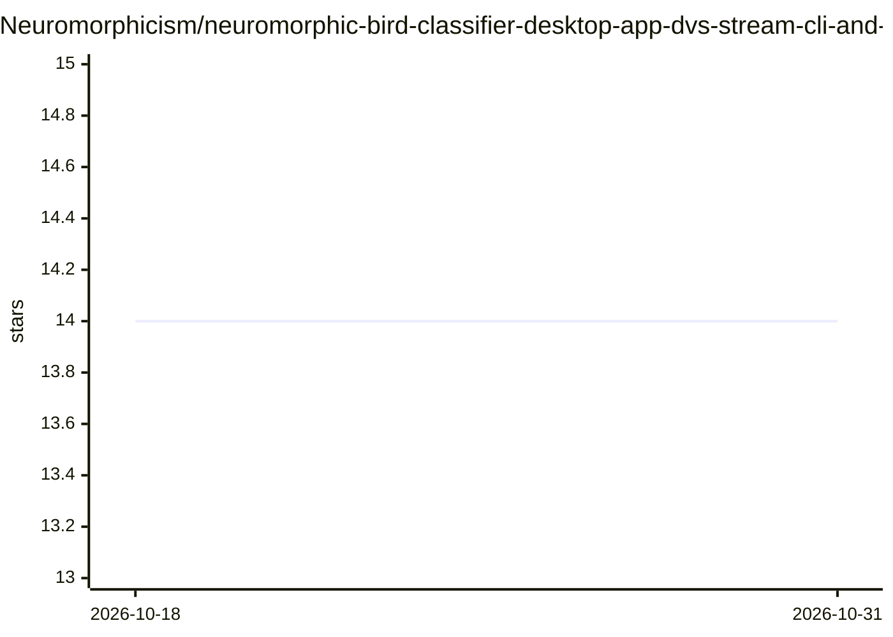

# Neuromorphicism/neuromorphic-bird-classifier-desktop-app-dvs-stream-cli-and-gui

⭐ 14 · Python · GPL-3.0 · 推送 2026-05-29 · [GitHub](https://github.com/Neuromorphicism/neuromorphic-bird-classifier-desktop-app-dvs-stream-cli-and-gui) · 个人维护

**用脉冲神经网络从事件相机流识别鸟类的桌面应用（CLI+GUI）**

基于 Norse 作为 SNN 推理引擎、Tonic 作为数据加载器的鸟类识别桌面应用，GUI 用 CustomTkinter 构建。内置基于 ICNS IEBCS 的实时事件相机模拟器，可从摄像头画面生成事件流，不依赖 CUDA。使用前需从 Hugging Face 下载 SNN 模型文件替换空模型。提供 GUI 与无界面 CLI 两种运行方式，记录被识别鸟类的日志、照片与事件视频。Linux 完整支持；Windows 上 AEStream 不可用（无推理引擎）；macOS 仅支持事件相机模拟器。

## 筛选速览

| 维度 | 判定 | 备注 |
|---|---|---|
| AI 角色 | `ai-native` | 本体是模型或模型工具 |
| 许可风险 | `viral` | GPL-3.0 |
| 部署形态 | `library` | 以包/库形式分发 |
| 模型依赖 | — | README 未给出锁定关系 |
| 硬件要求 | — | 无带数字的原话,不猜 |
| 安装摩擦 | `high` | 编译与系统依赖俱全 |
| 成熟度 | — | 结构信号不足 |

## 能力要点

- Norse SNN 推理引擎 + Tonic 数据加载的鸟类识别
- 内置不依赖 CUDA 的事件相机模拟器（基于 IEBCS）
- GUI 与 CLI 两种运行形式，可保存识别日志、照片与事件视频
- 在 AMD Kria KV260、ThinkPad、MacBook Pro 等系统上测试

## 适用场景

- 在桌面端实时识别摄像头画面中的鸟类
- 在无事件相机的环境下用模拟器生成事件流做分类
- 学习/演示神经形态计算与 SNN 桌面应用的搭建

## 场景标签

`目标检测` · 领域:感知与多模态

## 证据(README 行号)

> L10: This Python application uses Norse as its SNN inference engine and Tonic as the data loader. The GUI is created in 
> L12: The Live Event Camera Simulator is a custom tool based on ICNS IEBCS that does not require CUDA to run unlike other

## 星数曲线

2026-10-18 14 → 2026-10-31 14（+0）

---
*卡片 v1 · prompt 1.4 · 生成 2026-10-31 · 置信度 high · 依据 README sha `5b9691690164` · [字段定义](../../DATASET.md)*
