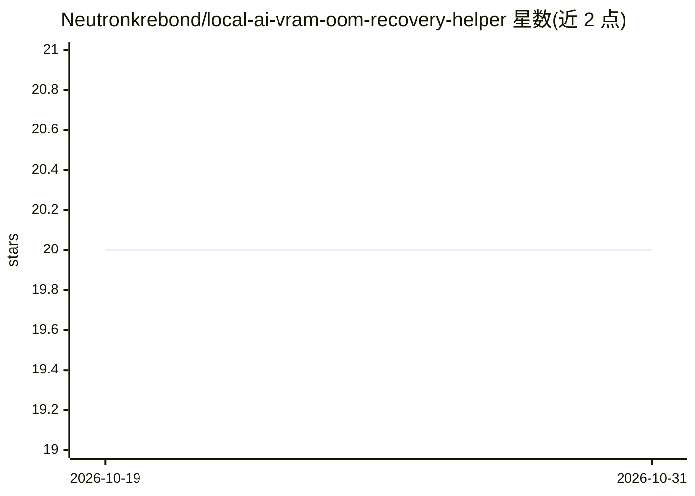

# Neutronkrebond/local-ai-vram-oom-recovery-helper

⭐ 20 · CSS · MIT · 推送 2026-10-19 · [GitHub](https://github.com/Neutronkrebond/local-ai-vram-oom-recovery-helper) · 个人维护

**Windows 本地 AI 显存溢出恢复工作流工具**

面向 Windows 的独立可执行工具，围绕本地 AI 场景下的内存溢出恢复、VRAM 报错与崩溃排查组织工作流：选择/检测模型、运行时、GPU 或 API 上下文，分析与保存配置，执行恢复步骤，并支持备份优先、可复用配置档与回滚到已知良好配置。安装方式为从 GitHub Releases 下载 ZIP 压缩包解压后运行 exe。README 声明为独立工具，非 Ollama、NVIDIA、AMD 或微软的官方工具，不含商业模型，不上传数据的行为需用户自行核验各运行时。

## 筛选速览

| 维度 | 判定 | 备注 |
|---|---|---|
| AI 角色 | `ai-ecosystem` | LLM/agent 周边工具 |
| 许可风险 | `permissive` | MIT |
| 部署形态 | `desktop` | 安装包/桌面程序 |
| 模型依赖 | — | README 未给出锁定关系 |
| 硬件要求 | — | 无带数字的原话,不猜 |
| 安装摩擦 | `low` | 无编译、无系统依赖或容器化 |
| 成熟度 | — | 结构信号不足 |

## 能力要点

- 围绕 OOM 恢复、VRAM 报错、本地 AI 崩溃的工作流
- 备份优先与可复用配置档
- 五步流程：选择/检测、分析、保存/应用、验证、恢复

## 适用场景

- 本地大模型加载时出现显存溢出后整理恢复步骤
- 对本地 AI 运行时配置做修改前备份与回滚
- 排查 Windows 上本地 AI 崩溃问题

## 场景标签

 · 领域:本地 AI 工具/系统维护

## 证据(README 行号)

> L19: **Local AI VRAM Out-of-Memory Recovery Helper** is designed to organize a Windows workflow around **out of memory r
> L43: 1. **Select / Detect** — choose the relevant model, runtime, GPU, API, or storage context.

## 星数曲线

2026-10-19 20 → 2026-10-31 20（+0）

---
*卡片 v1 · prompt 1.4 · 生成 2026-10-28 · 置信度 mid · 依据 README sha `7f3fea64034d` · [字段定义](../../DATASET.md)*
