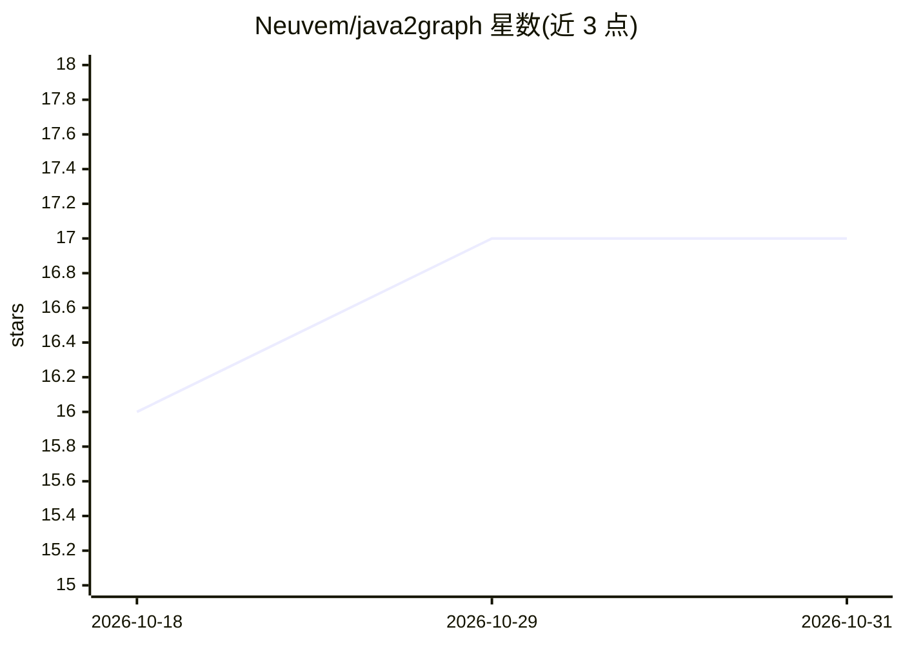

# Neuvem/java2graph

⭐ 17 · Java · Apache-2.0 · 推送 2026-05-26 · [GitHub](https://github.com/Neuvem/java2graph) · 组织维护

**为 AI Agent 生成 Java 代码属性图的 AST 解析器**

由 Neuvem 开发的 Java 代码库 AST 解析与 Code Property Graph（CPG）生成工具：读取 Java 源码目录，通过启发式 fastResolve 管线推导调用链与继承关系，经 Lombok 预处理后导出去重后的结构图到二进制 LadybugDB 数据库，可用 Open Cypher 查询，也可输出 CSV。面向需要为 AI Agent/GraphRAG 构建 Java 代码语义图谱的开发者。以 Java fat-jar 或 jpackage 打包的独立二进制（内嵌精简 JRE）形式提供，构建需 JDK 17 与 Maven 3+；查询结果需另装 Ladybug CLI。

## 筛选速览

| 维度 | 判定 | 备注 |
|---|---|---|
| AI 角色 | `ai-ecosystem` | LLM/agent 周边工具 |
| 许可风险 | `permissive` | Apache-2.0 |
| 部署形态 | `desktop` | 安装包/桌面程序 |
| 模型依赖 | — | README 未给出锁定关系 |
| 硬件要求 | — | 无带数字的原话,不猜 |
| 安装摩擦 | `medium` | 含编译或系统依赖之一 |
| 成熟度 | — | 结构信号不足 |

## 能力要点

- 启发式 fastResolve 管线推导调用链与继承关系
- 原生 Lombok 支持（DelombokPass 重建缺失 AST 实体）
- 去重结构图导出至 LadybugDB，支持 Open Cypher 查询
- jpackage 打包内嵌精简 JRE 的零依赖独立二进制

## 适用场景

- 为 AI Agent 构建大型 Java 单体的代码语义图
- GraphRAG 场景下将 Java 代码结构导入图数据库
- 用 Cypher 查询未解析方法调用或接口实现关系

## 场景标签

`知识图谱` · 领域:知识与检索

## 证据(README 行号)

> L3: **Java2Graph** is a high-performance, memory-optimized AST parser and Code Property Graph (CPG) generator for Java c
> L76: Once the extraction completes, the data is structured natively for `LadybugDB` queries via Open Cypher.

## 星数曲线

2026-10-18 16 → 2026-10-31 17（+1）

---
*卡片 v1 · prompt 1.4 · 生成 2026-10-30 · 置信度 high · 依据 README sha `02a862cad447` · [字段定义](../../DATASET.md)*
