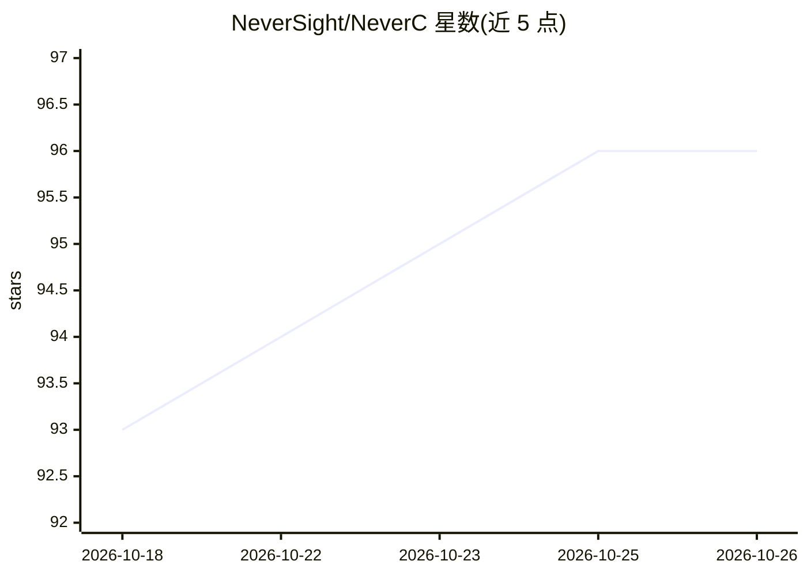

# NeverSight/NeverC

⭐ 96 · C · NOASSERTION · 推送 2026-10-25 · [GitHub](https://github.com/NeverSight/NeverC) · 组织维护 · 中文 README

**面向安全研究的 AI 友好 C23 编译器，基于 LLVM**

基于 LLVM 的 C23 编译器，单一可执行文件集成编译器、链接器（COFF/ELF/Mach-O）与内置运行时（string、mimalloc、xorstr、strhash），面向安全研究人员。目标平台为 x86_64 与 AArch64，支持从 macOS/Linux 交叉编译 Windows PE、Linux ELF、macOS Mach-O、Android ELF 及 DynCode，平台 SDK 随编译器分发。声明极简语法与确定性语义使 AI 生成的 NeverC 代码编译正确率高于 C++，提供纯 C ABI 插件接口可拦截 130 个编译阶段。以 curl/PowerShell 安装脚本安装预编译发布包。

## 筛选速览

| 维度 | 判定 | 备注 |
|---|---|---|
| AI 角色 | `ai-ecosystem` | LLM/agent 周边工具 |
| 许可风险 | `none` | NOASSERTION |
| 部署形态 | `desktop` | 安装包/桌面程序 |
| 模型依赖 | — | README 未给出锁定关系 |
| 硬件要求 | — | 无带数字的原话,不猜 |
| 安装摩擦 | `low` | 无编译、无系统依赖或容器化 |
| 成熟度 | — | 结构信号不足 |

## 能力要点

- 单二进制集成编译器+链接器+内置运行时，无外部依赖
- DynCode 管线：多级 IR/MIR、syscall 降低、bad-byte 审计、内核模式支持
- 内置 xorstr 编译期字符串加密与发布版符号剥离
- 纯 C ABI 插件 API 覆盖 driver 到 dyncode 共 130 个可命名阶段

## 适用场景

- 安全研究中生成跨平台 PE/ELF/Mach-O/dyncode 二进制
- 让 LLM 生成的 C23 代码以更简语法直接编译运行
- 编写拦截任意编译阶段的编译器插件

## 场景标签

`网络安全` · 领域:学习与行业

## 证据(README 行号)

> L7: **The AI-friendly C23 compiler for security research, built on LLVM**
> L32: - **LLM-friendly** — Minimal grammar and deterministic semantics mean AI-generated NeverC code compiles correctly m

## 星数曲线

2026-10-18 93 → 2026-10-26 96（+3）

---
*卡片 v1 · prompt 1.4 · 生成 2026-10-23 · 置信度 mid · 依据 README sha `30cda46f6c4f` · [字段定义](../../DATASET.md)*
