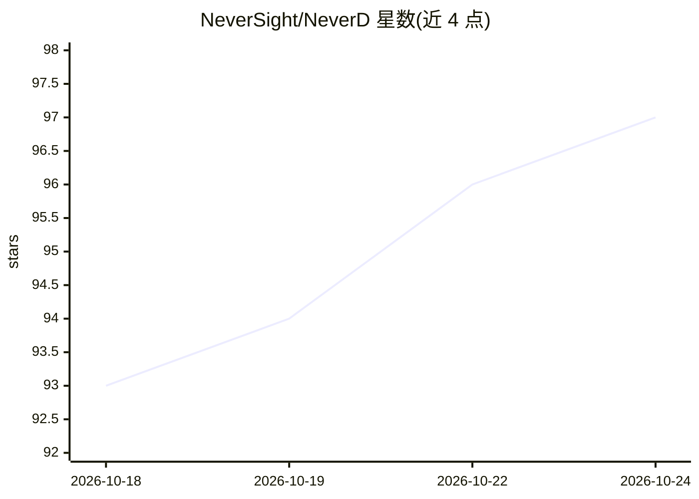

# NeverSight/NeverD

⭐ 98 · C++ · NOASSERTION · 推送 2026-10-24 · [GitHub](https://github.com/NeverSight/NeverD) · 组织维护 · 中文 README

**面向 AI 的二进制分析与反编译引擎，基于 LLVM 的 1:1 指令级提升**

NeverD 是原生与智能合约二进制的分析/反编译引擎，加载 PE、ELF、Mach-O、EVM 字节码与 Solana SBF 程序，经手写语义提升器生成 LLVM IR、C、Solidity、Rust 或重写后的原生二进制。默认严格模式：未提升指令抛出 UnliftedInstruction 而非跳过。CLI、集成方与 AI agent 通过纯 C API 的 libneverd 共用同一引擎，输出结构化 JSON。源码含 LLVM fork 子模块，需 CMake+Ninja 本地编译（首次约 30-60 分钟），或用预编译 LLVM 包。支持 Android/iOS 源恢复（实验性）与桌面工作台。仓库标注 WIP。

## 筛选速览

| 维度 | 判定 | 备注 |
|---|---|---|
| AI 角色 | `ai-ecosystem` | LLM/agent 周边工具 |
| 许可风险 | `none` | NOASSERTION |
| 部署形态 | `desktop` | 安装包/桌面程序 |
| 模型依赖 | — | README 未给出锁定关系 |
| 硬件要求 | — | 无带数字的原话,不猜 |
| 安装摩擦 | `medium` | 含编译或系统依赖之一 |
| 成熟度 | `idea` | |

## 能力要点

- PE/ELF/Mach-O/EVM/SBF 多格式，1:1 指令级提升至 LLVM IR、C、Solidity、Rust
- 纯 C API 的 libneverd，CLI 与 AI agent 共用引擎，结构化 JSON 输出
- 默认严格模式：未提升指令抛异常而非静默 NOP
- 二进制重写（patch）与 Android/iOS 移动端源恢复（实验性）

## 适用场景

- 逆向分析原生可执行文件或智能合约并反编译为 C/Solidity/Rust
- 通过纯 C API 或 JSON 输出让 AI agent 消费二进制分析结果
- 对混淆或虚拟化代码做实验性解释器恢复

## 场景标签

`网络安全` · 领域:学习与行业

## 证据(README 行号)

> L26: CLI tools, integrators, and AI agents use one engine — **`libneverd`** — through a **pure C API**. They do not link
> L33: - **LLM-friendly** — structured C, LLVM IR, and JSON analysis through a pure C API with deterministic errors

## 星数曲线

2026-10-18 93 → 2026-10-24 97（+4）

---
*卡片 v1 · prompt 1.4 · 生成 2026-10-23 · 置信度 high · 依据 README sha `794eaf47f0cf` · [字段定义](../../DATASET.md)*
