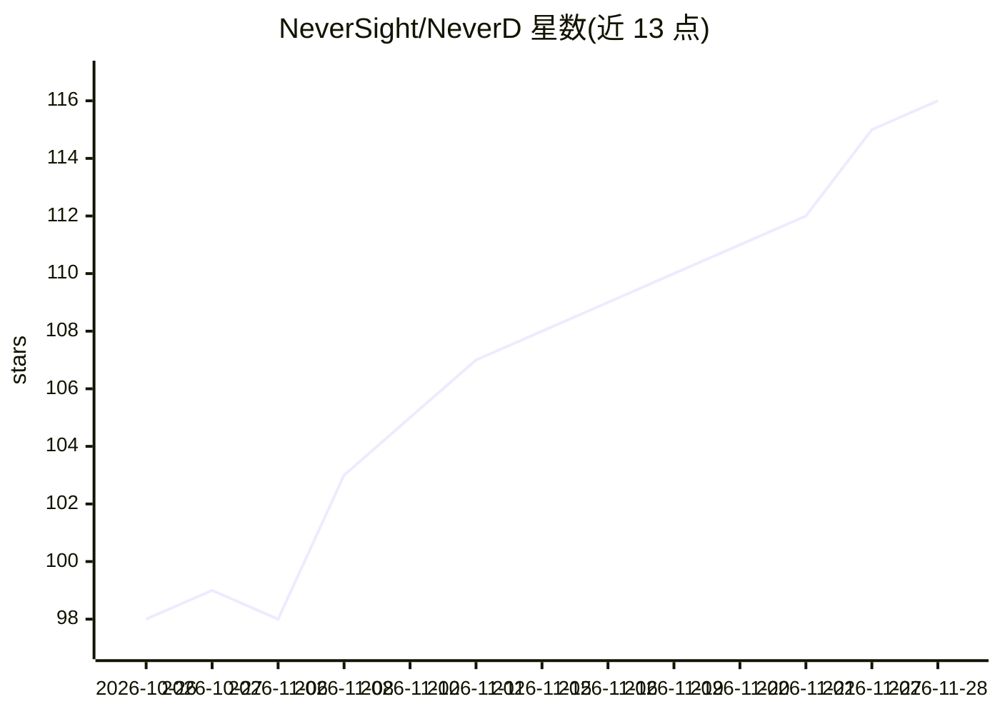

# NeverSight/NeverD

⭐ 116 · C++ · NOASSERTION · 推送 2026-11-27 · [GitHub](https://github.com/NeverSight/NeverD) · 组织维护 · 中文 README

**基于 LLVM 的二进制分析与反编译引擎，面向 AI 代理**

NeverD 是原生程序与智能合约的分析/反编译引擎，以 1:1 指令级 lift 为核心：加载 PE、ELF、Mach-O、EVM 字节码与 Solana SBF ELF，经手写语义的 Low/Med/High IR 管线输出 LLVM IR、C、Solidity、Rust 或重写后的二进制。默认严格模式，无 lifter 的指令抛异常而非猜测。CLI、集成方与 AI 代理通过纯 C API 使用同一引擎 libneverd；另有实验性 Android/iOS 源码恢复与可选 Qt 桌面工作台。项目标注 WIP，CMake 构建本地 LLVM fork 需 30–60 分钟。

## 筛选速览

| 维度 | 判定 | 备注 |
|---|---|---|
| AI 角色 | `ai-enhanced` | 去掉 AI 部分产品仍成立 |
| 许可风险 | `none` | NOASSERTION |
| 部署形态 | `desktop` | 安装包/桌面程序 |
| 模型依赖 | — | README 未给出锁定关系 |
| 硬件要求 | — | 无带数字的原话,不猜 |
| 安装摩擦 | `medium` | 含编译或系统依赖之一 |
| 成熟度 | `idea` | |

## 能力要点

- 1:1 指令级 lift，严格模式默认开启，不支持指令抛 UnliftedInstruction
- 单一管线多出口：lift→LLVM IR、decompile→C/Solidity/Rust、patch→重写二进制
- 纯 C API（libneverd）供 CLI、集成方与 AI 代理共用，输出结构化 JSON 分析
- 覆盖 x86-64/i386/AArch64/ARM32 及 MIPS、RISC-V、PowerPC、EVM、SBF 等目标

## 适用场景

- 将无源码的二进制反编译为 C/Rust/Solidity 供审计
- 为 AI 代理提供确定性的二进制结构化分析输出
- 对 PE/ELF/Mach-O 做函数级补丁与二进制重写
- 恢复 APK/IPA 中的源码（实验性）

## 场景标签

`网络安全` · 领域:学习与行业

## 证据(README 行号)

> L26: CLI tools, integrators, and AI agents use one engine — **`libneverd`** — through a **pure C API**. They do not link
> L33: - **LLM-friendly** — structured C, LLVM IR, and JSON analysis through a pure C API with deterministic errors

## 星数曲线

2026-10-26 98 → 2026-11-28 116（+18）

---
*卡片 v1 · prompt 1.4 · 生成 2026-11-28 · 置信度 mid · 依据 README sha `1c9619a97a18` · [字段定义](../../DATASET.md)*
