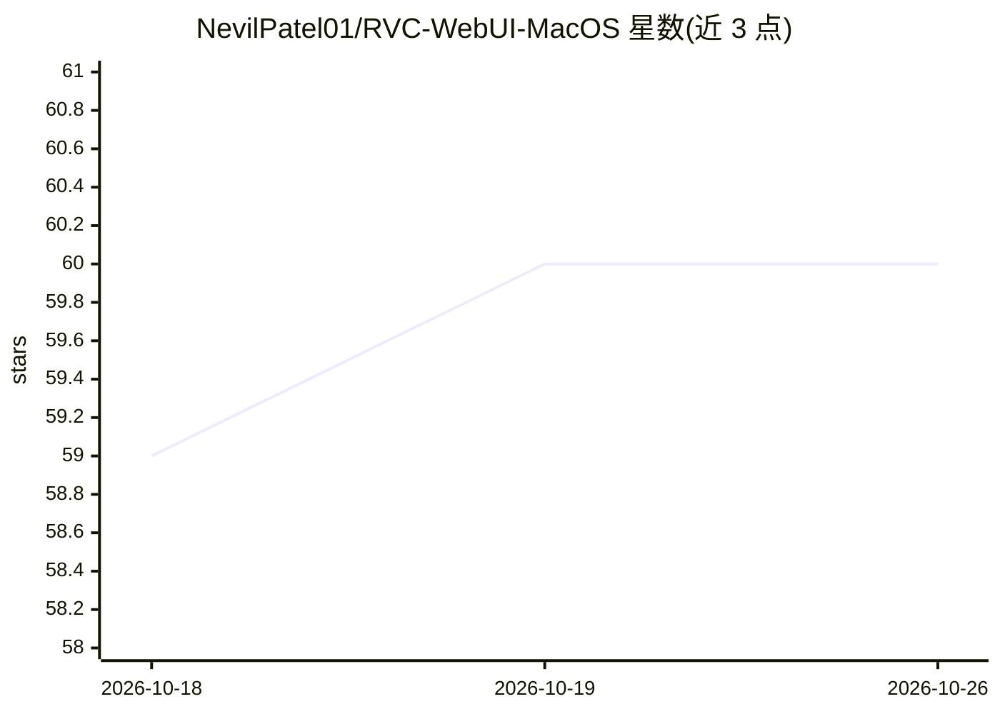

# NevilPatel01/RVC-WebUI-MacOS

⭐ 60 · Python · AGPL-3.0 · 推送 2026-01-31 · [GitHub](https://github.com/NevilPatel01/RVC-WebUI-MacOS) · 个人维护 · 中文 README

**面向 Apple Silicon Mac 的语音变换（RVC）训练与推理 WebUI**

基于 VITS 的检索式语音变换框架的 macOS 适配版：提供训练与推理 WebUI 及实时变声 GUI，支持小数据量（10 分钟起）训练自定义音色模型、模型融合、UVR5 人声分离、RMVPE 音高提取。本仓库针对 Apple Silicon（M1/M2/M3）优化，运行时自动使用 MPS（Metal Performance Shaders），并自带全部所需模型文件，无需额外下载。通过 git clone 源码 + venv + pip 安装依赖后运行 web.py 启动。限制：需 macOS 12+、Python 3.10+、8GB 内存起步（推荐 16GB）、10GB 磁盘空间。

## 筛选速览

| 维度 | 判定 | 备注 |
|---|---|---|
| AI 角色 | `ai-native` | 本体是模型或模型工具 |
| 许可风险 | `viral` | AGPL-3.0 |
| 部署形态 | `library` | 以包/库形式分发 |
| 模型依赖 | — | README 未给出锁定关系 |
| 硬件要求 | — | 无带数字的原话,不猜 |
| 安装摩擦 | `medium` | 含编译或系统依赖之一 |
| 成熟度 | — | 结构信号不足 |

## 能力要点

- 基于检索的语音变换（VITS 框架），支持训练与推理 WebUI 及实时变声 GUI
- 针对 Apple Silicon（M1/M2/M3）优化，无 NVIDIA GPU 时自动使用 MPS
- 仓库自带全部所需模型文件，无需额外下载
- 支持 10 分钟以上语音数据训练自定义音色模型、模型融合与 UVR5 人声分离

## 适用场景

- 在 Mac 上用自己的语音数据训练并转换音色
- 实时语音变换（变声）
- 分离人声与伴奏，提取干声用于训练

## 场景标签

`语音合成` `微调` · 领域:内容生成

## 证据(README 行号)

> L207: - Voice conversion with high-quality results
> L211: - Real-time voice conversion

## 星数曲线

2026-10-18 59 → 2026-10-26 60（+1）

---
*卡片 v1 · prompt 1.4 · 生成 2026-10-24 · 置信度 mid · 依据 README sha `1b55b324882a` · [字段定义](../../DATASET.md)*
