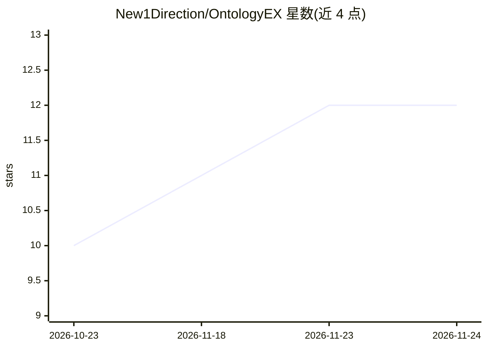

# New1Direction/OntologyEX

⭐ 12 · Python · MIT · 推送 2026-11-19 · [GitHub](https://github.com/New1Direction/OntologyEX) · [官网](https://new1direction.github.io/OntologyEX/) · 个人维护

**让 AI 代理理解代码背后业务的可移植本体提取工具包**

指向一个代码仓库后，代理克隆该工具包、只读扫描目标仓库并生成一页离线业务概览：服务对象、资金流、主要旅程、风险点与归属，每条结论附源码行号引用。提供 Python 本地控制室（九个视图：业务、指挥中心、合规、归属者、周报、供应商、影响、实体、系统图），内置 16 个只读 MCP 工具与 3 个提议类工具供代理查询同一模型，guardrail.py 可为 Claude Code 安装规则钩子。结论分 CONFIRMED/SOURCE/INFERRED/UNKNOWN 四级，需 Python 3.11+ 与 PyYAML，控制室仅监听 loopback。

## 筛选速览

| 维度 | 判定 | 备注 |
|---|---|---|
| AI 角色 | `ai-native` | 本体是模型或模型工具 |
| 许可风险 | `permissive` | MIT |
| 部署形态 | `library` | 以包/库形式分发 |
| 模型依赖 | — | README 未给出锁定关系 |
| 硬件要求 | — | 无带数字的原话,不猜 |
| 安装摩擦 | `low` | 无编译、无系统依赖或容器化 |
| 成熟度 | — | 结构信号不足 |

## 能力要点

- 四层本体提取（upper/domain/task/application），每条声明链接到源码行
- 本地控制室提供九个视图，包括 SOC 2/PCI DSS/HIPAA/GDPR 逐条证据映射
- MCP 服务器提供 16 个只读工具与 3 个人工确认的提议工具，无破坏性工具
- 结论四级置信（CONFIRMED/SOURCE/INFERRED/UNKNOWN）， weakest-link 传播

## 适用场景

- 接入新代码库时快速弄清业务流程、归属与外部供应商依赖
- 审计前准备：把合规控制映射到代码证据并标注缺口
- 合并前评估分支对业务的影响范围
- 给代理加规则护栏，拦截违反业务任务的工具调用

## 场景标签

`知识图谱` · 领域:知识与检索

## 证据(README 行号)

> L3: **Point an agent at a repository. Get back the business it runs:**
> L26: That is the whole interface. Your agent clones the kit, reads your repository (it never runs
> L142: An MCP server over the running control room. **Sixteen read tools**: `check_answerable`, `what_needs_attention`,

## 星数曲线

2026-10-23 10 → 2026-11-24 12（+2）

---
*卡片 v1 · prompt 1.4 · 生成 2026-11-19 · 置信度 mid · 依据 README sha `63c450069ea4` · [字段定义](../../DATASET.md)*
