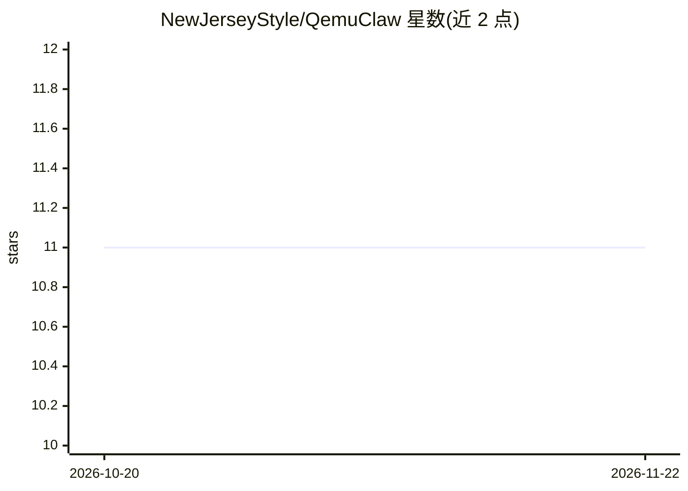

# NewJerseyStyle/QemuClaw

⭐ 11 · JavaScript · MIT · 推送 2026-11-21 · [GitHub](https://github.com/NewJerseyStyle/QemuClaw) · 个人维护 · 中文 README

**在 QEMU 虚拟机中一键隔离部署 OpenClaw 个人 AI 助手**

提供 Electron 桌面应用（Windows/macOS/Linux）与手动 QEMU 两种路径，将 OpenClaw 个人 AI 助手运行在隔离的虚拟机镜像中：首次启动向导配置内存、CPU 与共享文件夹，自动下载 VM 镜像并无头启动，通过系统托盘打开 Web UI 完成接入。README 引用 OpenClaw 存在远程代码执行类漏洞作为隔离动机；VM 内可经 host.local（10.0.2.2）访问宿主机上的本地 LLM 服务（如 Ollama、LM Studio）。开发需 Node.js 18+ 与 QEMU。

## 筛选速览

| 维度 | 判定 | 备注 |
|---|---|---|
| AI 角色 | `ai-ecosystem` | LLM/agent 周边工具 |
| 许可风险 | `permissive` | MIT |
| 部署形态 | `desktop` | 安装包/桌面程序 |
| 模型依赖 | local-ok | 支持本地模型 |
| 硬件要求 | — | 无带数字的原话,不猜 |
| 安装摩擦 | `low` | 无编译、无系统依赖或容器化 |
| 成熟度 | — | 结构信号不足 |

## 能力要点

- Windows 安装包内置 QEMU 与 7-Zip，无需额外配置
- 首次启动向导配置 VM 资源并自动下载镜像、无头启动
- VM 经 host.local 网关访问宿主机本地 LLM 服务
- 提供 .qcow2 VM 镜像与手动 QEMU 启动命令

## 适用场景

- 把 OpenClaw 助手与主系统隔离运行
- 让 VM 内的助手调用宿主机上的 Ollama/LM Studio 本地模型
- 不想手动配置 QEMU 的桌面用户一键部署

## 场景标签

`网络安全` · 领域:学习与行业

## 证据(README 行号)

> L6: One-click isolated deployment for OpenClaw — a personal AI assistant running securely inside a QEMU virtual machine.
> L94: QemuClaw (Electron app)

## 星数曲线

2026-10-20 11 → 2026-11-22 11（+0）

---
*卡片 v1 · prompt 1.4 · 生成 2026-11-19 · 置信度 high · 依据 README sha `2f3e290afb3f` · [字段定义](../../DATASET.md)*
