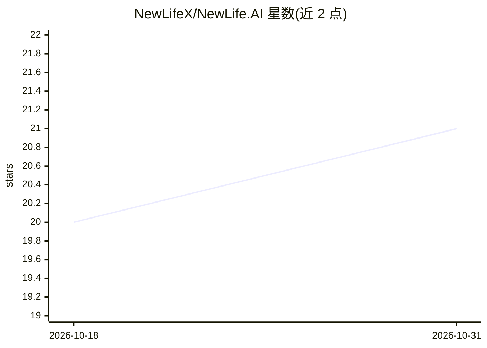

# NewLifeX/NewLife.AI

⭐ 21 · C# · Apache-2.0 · 推送 2026-10-26 · [GitHub](https://github.com/NewLifeX/NewLife.AI) · 组织维护 · 中文 README

**.NET 统一 AI 网关库：46 家 LLM 服务商单一接口接入**

面向 .NET 生态的 AI 基础设施库，以统一 IChatClient 接口封装 46 家 LLM 服务商（9 个独立协议客户端 + 37 个 OpenAI 兼容适配），支持函数调用、双向 MCP、流式输出、多 Agent、记忆与知识库等能力，覆盖 net45→net10.0 并支持 NativeAOT。另含 NewLife.ChatAI：基于 ASP.NET Core 的完整 Web 聊天应用，内置多协议 AI 网关（OpenAI/Anthropic/Gemini 路由）、AppKey 多租户与用量统计，可独立部署或经 NuGet 嵌入现有项目。通过 dotnet add package 安装，Web 应用默认 SQLite 开箱即用。

## 筛选速览

| 维度 | 判定 | 备注 |
|---|---|---|
| AI 角色 | `ai-ecosystem` | LLM/agent 周边工具 |
| 许可风险 | `permissive` | Apache-2.0 |
| 部署形态 | `None` |  |
| 模型依赖 | local-ok | 支持本地模型 |
| 硬件要求 | — | 无带数字的原话,不猜 |
| 安装摩擦 | `medium` | 含编译或系统依赖之一 |
| 成熟度 | — | 结构信号不足 |

## 能力要点

- 46 家服务商、6 种协议，单一 IChatClient 接口切换
- 双向 MCP 支持（客户端连外部 Server，也可将本地工具暴露为 MCP 服务）
- 内置多协议 AI 网关：OpenAI/Anthropic/Gemini 路由、429 指数退避重试、用量统计
- 31 种运行时语言，覆盖 Windows/Linux/macOS/Android/iOS 多架构（含 loongarch64/riscv64）

## 适用场景

- 在 .NET 项目中以统一接口接入多家 LLM 服务商并按需切换
- 部署开箱即用的多模型 Web 聊天应用（NewLife.ChatAI）
- 为第三方系统提供 OpenAI/Anthropic/Gemini 兼容的统一 AI 网关入口

## 场景标签

`模型网关` `聊天机器人` · 领域:Agent 开发

## 证据(README 行号)

> L22: **NewLife.AI** is an open-source AI foundation library for the .NET ecosystem, providing a unified `IChatClient` in
> L32: - **46 AI Providers, 6 Protocols**: OpenAI / Anthropic / Gemini / Tongyi DashScope / Ollama / AWS Bedrock — switch 
> L38: - **Unified AI Gateway**: Compatible with OpenAI / Anthropic / Gemini protocols; snake_case/camelCase auto-adaptati

## 星数曲线

2026-10-18 20 → 2026-10-31 21（+1）

---
*卡片 v1 · prompt 1.4 · 生成 2026-10-28 · 置信度 high · 依据 README sha `4a411af323e4` · [字段定义](../../DATASET.md)*
