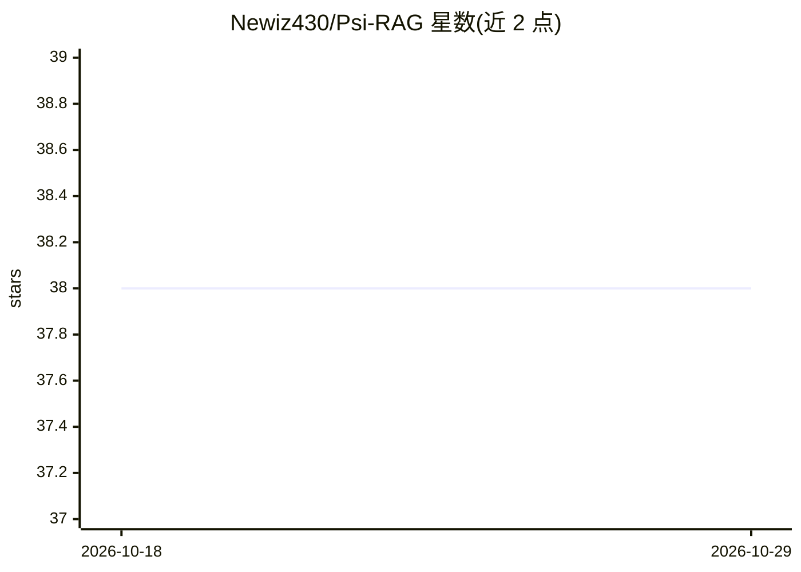

# Newiz430/Psi-RAG

⭐ 38 · Python · MIT · 推送 2026-08-28 · [GitHub](https://github.com/Newiz430/Psi-RAG) · 个人维护

**层次抽象树索引的跨文档 RAG 框架（ICML'26）**

面向复杂多跳信息检索的 RAG 框架：用语料级层次抽象树索引组织文档（ summaries 或 keywords 两种抽象策略），配合多粒度 agentic 检索器（Reading & Answering agent、BM25 混合检索、可选 reranker）实现跨文档检索与回答，检索为对数时间复杂度。提供桶划分 + HNSW 支持千万 token 级语料，含 2 层 MLP 查询跳数判别器（最多 4 跳）。基于开源 LLM（Ollama/vLLM 后端），以 Python 脚本与配置文件驱动，支持本地 PDF 语料建索引，内置 NQ/HotpotQA/2Wiki/MuSiQue/MultiHop-RAG 基准与复现管线。

## 筛选速览

| 维度 | 判定 | 备注 |
|---|---|---|
| AI 角色 | `ai-ecosystem` | LLM/agent 周边工具 |
| 许可风险 | `permissive` | MIT |
| 部署形态 | `library` | 以包/库形式分发 |
| 模型依赖 | local-ok | 支持本地模型 |
| 硬件要求 | — | 无带数字的原话,不猜 |
| 安装摩擦 | `medium` | 含编译或系统依赖之一 |
| 成熟度 | — | 结构信号不足 |

## 能力要点

- 语料级层次抽象树索引，两块 48G RTX4090 上 3 小时内索引百万级 token
- 多粒度 agentic 检索管线：跨文档多跳树搜索 + BM25 混合检索 + reranker 支持
- 桶划分 + HNSW 近似排序支持 10M+ token 大规模语料
- 2 层 MLP 查询跳数判别器自动决定最大检索次数（最多 4 跳）

## 适用场景

- 在多文档语料上做跨文档多跳问答
- 把本地 PDF 文件夹构建为树索引后对话式检索
- 复现 HotpotQA/MuSiQue 等 RAG 基准实验

## 场景标签

`RAG` · 领域:知识与检索

## 证据(README 行号)

> L22: $\Psi$-RAG is an efficient and powerful hierarchical tree-based RAG framework designed to tackle complex informatio
> L32: - **👨‍👩‍👧‍👦 Multi-granular and Multifunctional Retrieval Pipeline**: Iterative agentic retrieval empowers cross-doc

## 星数曲线

2026-10-18 38 → 2026-10-29 38（+0）

---
*卡片 v1 · prompt 1.4 · 生成 2026-10-25 · 置信度 high · 依据 README sha `1c1ccca44337` · [字段定义](../../DATASET.md)*
