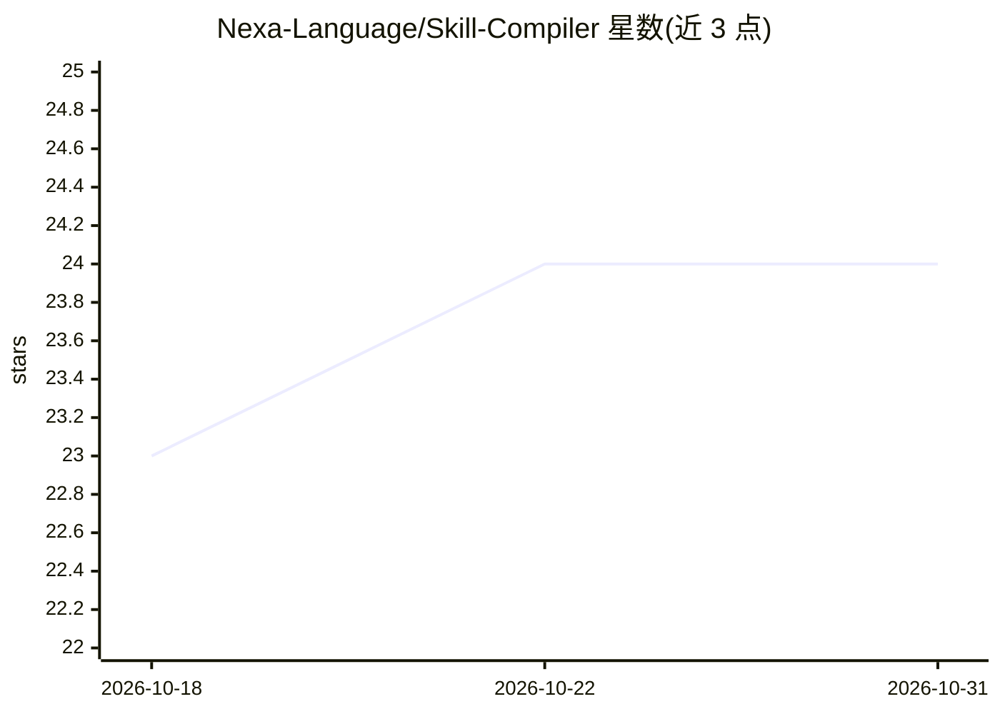

# Nexa-Language/Skill-Compiler

⭐ 24 · Rust · 推送 2026-07-10 · [GitHub](https://github.com/Nexa-Language/Skill-Compiler) · [官网](http://skcc.nexa-lang.com/) · 组织维护 · 中文 README

**把统一 SKILL.md 编译为多平台 Agent 技能的编译器**

SkCC 是用 Rust 实现的 LLM Agent 技能编译框架：通过 Syntax Parser → IR Builder → Security Optimizer → Target Emitter 四阶段流水线，将统一的 SKILL.md 源文件编译为 Claude Code、OpenAI Codex、Gemini CLI、Kimi CLI 的平台原生技能产物。核心机制为统一中间表示 SkIR（解耦技能语义与框架格式）与编译期 Anti-Skill 注入安全加固（四类反模式规则、HITL 高风险确认）。提供 npm 包与 CLI（nsc build），另提及 VS Code 扩展。编译目标格式按模型差异各有侧重（Claude XML 分层、Gemini 条件 YAML 等）。论文被 ACM CAIS 2026 AgentSkills'26 Workshop 以 poster 接收。

## 筛选速览

| 维度 | 判定 | 备注 |
|---|---|---|
| AI 角色 | `ai-ecosystem` | LLM/agent 周边工具 |
| 许可风险 | `none` | — |
| 部署形态 | `library` | 以包/库形式分发 |
| 模型依赖 | — | README 未给出锁定关系 |
| 硬件要求 | — | 无带数字的原话,不猜 |
| 安装摩擦 | `low` | 无编译、无系统依赖或容器化 |
| 成熟度 | — | 结构信号不足 |

## 能力要点

- 四阶段编译流水线将 SKILL.md 编译为四个平台的原生技能产物
- 统一中间表示 SkIR 将适配复杂度从 O(m×n) 降至 O(m+n)
- 编译期 Anti-Skill 注入（四类反模式规则）与四级安全模型验证
- Rust 实现，225 个技能平均编译延迟 8.93ms，内存峰值 <50MB

## 适用场景

- 一次编写技能，分发到 Claude Code / Codex / Gemini CLI / Kimi CLI 多个 Agent 框架
- 对社区技能做权限静态分析与安全加固后再部署
- 在编译期拦截含安全违规的技能（Fail-Fast）

## 场景标签

`Agent 框架` · 领域:Agent 开发

## 证据(README 行号)

> L34: **SkCC**（Skill Compiler for Cross-framework LLM Agents）是一个将经典编译器设计引入 Agent 技能开发的编译框架。通过四阶段流水线——Syntax Parser → IR B
> L140: |Crate|用途|
> L160: - ✅ 多平台编译（Claude、Codex、Gemini、Kimi）

## 星数曲线

2026-10-18 23 → 2026-10-31 24（+1）

---
*卡片 v1 · prompt 1.4 · 生成 2026-10-27 · 置信度 high · 依据 README sha `e8cc9eeeb314` · [字段定义](../../DATASET.md)*
