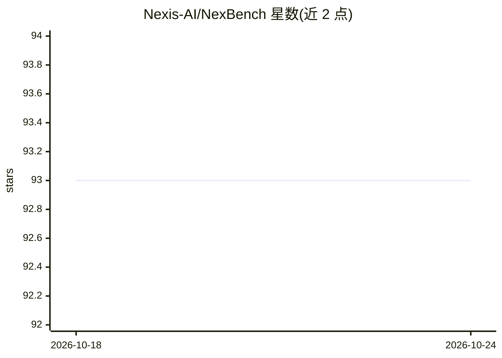

# Nexis-AI/NexBench

⭐ 93 · TypeScript · Apache-2.0 · 推送 2026-07-17 · [GitHub](https://github.com/Nexis-AI/NexBench) · [官网](https://nex-t1.ai) · 组织维护

**自主 Web3 agent 链上能力评测基准：214 任务、确定性分叉主网**

面向自主区块链 agent 的可复现评测套件：在确定性分叉主网环境（Ethereum/Base/Arbitrum 等 8 条链）中，以 214 个任务、每任务 5 次试验评测链上执行、兑换路由、跨链桥接、DeFi 操作、代币研究、安全威胁检测、组合分析与治理金库共 8 类能力。评分采用程序化验证器断言链上状态与数值答案，不使用 LLM 评审；结果以 SHA-256 内容哈希运行清单与 Merkle 根做防篡改。以 npm 包与 Python SDK 提供，公开仓库仅含 6 个可本地运行任务，其余 190 个任务保留轮换。

## 筛选速览

| 维度 | 判定 | 备注 |
|---|---|---|
| AI 角色 | `ai-ecosystem` | LLM/agent 周边工具 |
| 许可风险 | `permissive` | Apache-2.0 |
| 部署形态 | `library` | 以包/库形式分发 |
| 模型依赖 | — | README 未给出锁定关系 |
| 硬件要求 | — | 无带数字的原话,不猜 |
| 安装摩擦 | `low` | 无编译、无系统依赖或容器化 |
| 成熟度 | — | 结构信号不足 |

## 能力要点

- 程序化验证器基于链上状态/余额/事件日志断言，非 LLM 评审
- 确定性分叉主网环境，每次运行重放相同状态，无外网访问
- pass@1 与 pass⁵ 双指标，安全违规率 SVR 独立统计
- 运行清单哈希密封、Merkle 根证据链与 12 项提交检查

## 适用场景

- 评测自主链上 agent 的真实执行与安全能力
- 将基准接入 CI 作为 PR 回归门槛（无需 API key，离线运行）
- 提交成绩至排行榜并做可验证的防作弊审计

## 场景标签

`模型评测` · 领域:评测与运维

## 证据(README 行号)

> L3: **The reproducible benchmark for autonomous Web3 agents.**
> L14: NEXBENCH measures what an autonomous agent can actually *do* on-chain — execute transactions, route swaps, bridge f
> L18: - **Programmatic verifiers, not LLM judges.** Every task is graded by asserting on post-run chain state, balances, 

## 星数曲线

2026-10-18 93 → 2026-10-24 93（+0）

---
*卡片 v1 · prompt 1.4 · 生成 2026-10-23 · 置信度 high · 依据 README sha `b922623ba770` · [字段定义](../../DATASET.md)*
