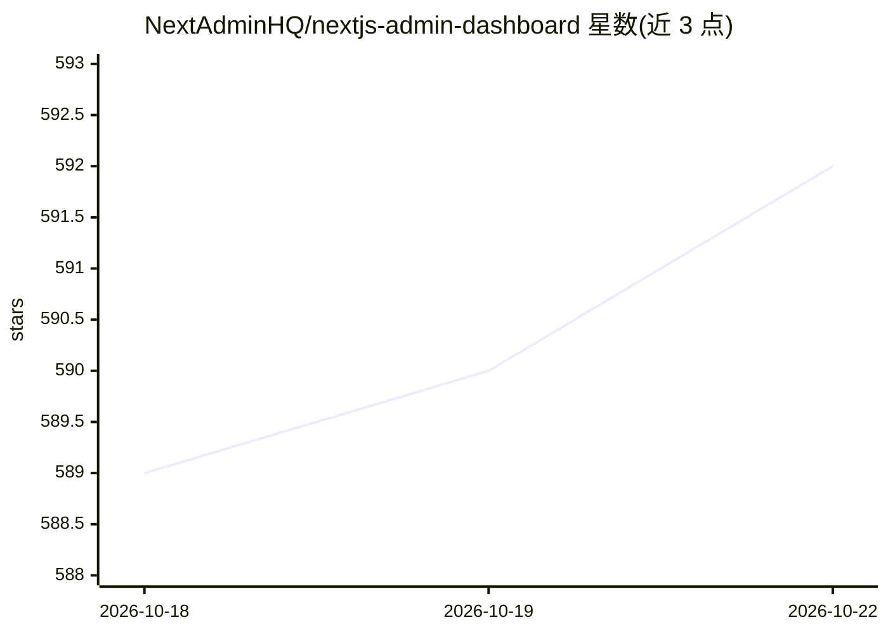

# NextAdminHQ/nextjs-admin-dashboard

⭐ 592 · TypeScript · 推送 2026-08-18 · [GitHub](https://github.com/NextAdminHQ/nextjs-admin-dashboard) · [官网](https://nextadmin.co) · 组织维护

**为 AI 代码代理提供规则与上下文的 Next.js 管理后台模板**

免费开源的 Next.js 16 + Tailwind CSS 管理后台模板，包含 200+ UI 组件、预置页面（登录/注册/设置/日历等）、多套仪表盘、深浅色模式与 Figma 设计源，页面连接 mock REST API，集成 TailGrids UI、Recharts、Leaflet、TanStack Table、Zod、FullCalendar。v2.0 加入 AI 规则与上下文文件（AGENTS.md、Agent Skills、Custom Prompts），供 Claude Code、Cursor、Codex 等代理读取项目结构后按既有模式开发；另有付费 Pro 版本提供更多组件与 Figma 文件。

## 筛选速览

| 维度 | 判定 | 备注 |
|---|---|---|
| AI 角色 | `ai-enhanced` | 去掉 AI 部分产品仍成立 |
| 许可风险 | `none` | — |
| 部署形态 | `library` | 以包/库形式分发 |
| 模型依赖 | — | README 未给出锁定关系 |
| 硬件要求 | — | 无带数字的原话,不猜 |
| 安装摩擦 | `low` | 无编译、无系统依赖或容器化 |
| 成熟度 | — | 结构信号不足 |

## 能力要点

- 200+ UI 组件与多套预置仪表盘页面，连接 mock REST API
- AGENTS.md 与 Agent Skills 供 AI 代理读取项目模式，跨会话保持一致结构
- api-integration skill 可通过单一提示将 mock 数据替换为真实接口
- 内置深浅色模式与 Figma 设计源

## 适用场景

- 快速搭建管理后台项目起点
- 配合 Claude Code/Cursor 等 AI 代理开发，保持目录与样式模式一致
- 替换 mock API 接入自有后端接口

## 场景标签

 · 领域:Web 前端/管理后台模板

## 证据(README 行号)

> L2: **NextAdmin** is a free, open-source Next.js admin dashboard with essential UI components, blocks, pages, and multip
> L29: - **200+ UI components** covering tables, forms, charts, cards, modals, and dashboard elements
> L63: Open the project in Claude Code, Cursor, Codex, Copilot, or Zed. Your agent reads `AGENTS.md` and the skill files, 

## 星数曲线

2026-10-18 589 → 2026-10-22 592（+3）

---
*卡片 v1 · prompt 1.4 · 生成 2026-10-21 · 置信度 high · 依据 README sha `2551b395336a` · [字段定义](../../DATASET.md)*
