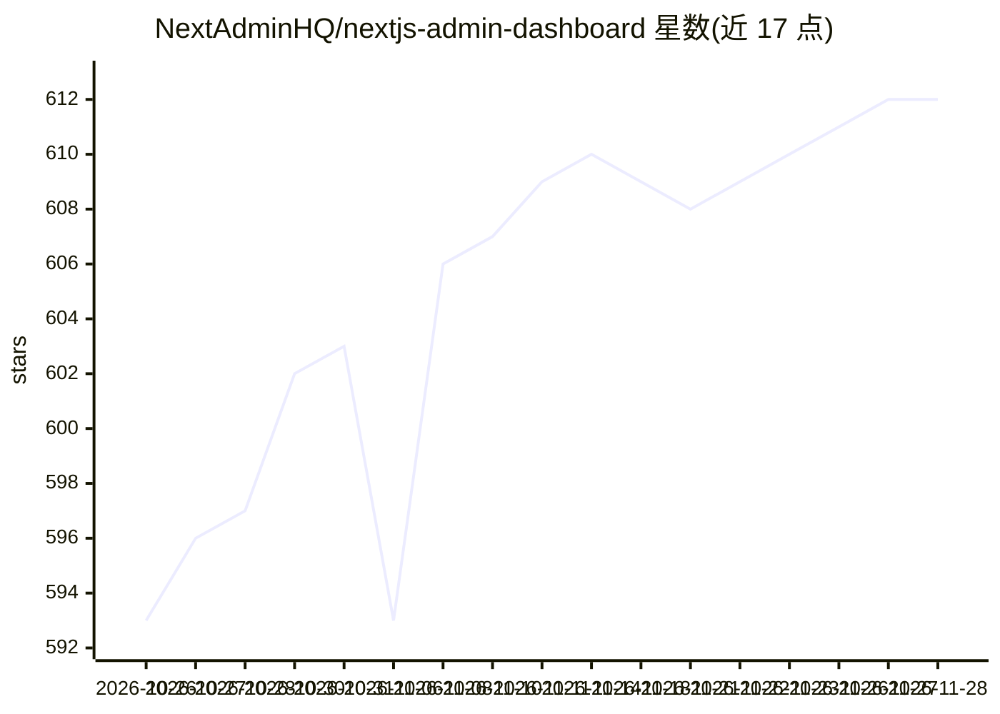

# NextAdminHQ/nextjs-admin-dashboard

⭐ 612 · TypeScript · 推送 2026-11-10 · [GitHub](https://github.com/NextAdminHQ/nextjs-admin-dashboard) · [官网](https://nextadmin.co) · 组织维护

**为开发者提供带 AI agent 协作规范的 Next.js 后台仪表盘模板**

基于 Next.js 16 与 Tailwind CSS 的开源后台管理模板，内置 200+ UI 组件、多种仪表盘（分析/电商/CRM/营销）、登录注册等预置页面与 mock REST API，集成 Recharts、TanStack Table、Leaflet、Zod 等。v2.0 加入 AGENTS.md 规范、Agent Skills 与 Custom Prompts，使 Claude Code、Cursor 等 agent 在已有代码结构上开发并保持模式一致。免费版组件之外另有 Pro 付费版本提供完整组件集与 Figma 文件。

## 筛选速览

| 维度 | 判定 | 备注 |
|---|---|---|
| AI 角色 | `ai-enhanced` | 去掉 AI 部分产品仍成立 |
| 许可风险 | `none` | — |
| 部署形态 | `library` | 以包/库形式分发 |
| 模型依赖 | — | README 未给出锁定关系 |
| 硬件要求 | — | 无带数字的原话,不猜 |
| 安装摩擦 | `low` | 无编译、无系统依赖或容器化 |
| 成熟度 | `idea` | |

## 能力要点

- 200+ UI 组件与多种仪表盘预置页面，接 mock REST API
- AGENTS.md 与 Agent Skills 让 AI agent 按既有代码结构开发
- api-integration 技能可将 mock 数据替换为真实接口
- 支持深浅色模式并提供 Figma 设计源文件

## 适用场景

- 快速搭建分析、电商、CRM 等后台仪表盘
- 在多轮 AI agent 会话中保持代码风格与结构一致
- 用一条提示把 mock 数据替换为真实后端接口

## 场景标签

 · 领域:Web 开发/后台管理模板

## 证据(README 行号)

> L3: **NextAdmin** is a free, open-source Next.js admin dashboard with essential UI components, blocks, pages, and multip
> L87: The free version covers most of what you need to get a dashboard running. If you want the full set of components, e

## 星数曲线

2026-10-26 593 → 2026-11-28 612（+19）

---
*卡片 v1 · prompt 1.4 · 生成 2026-11-25 · 置信度 high · 依据 README sha `9b9ad546dd55` · [字段定义](../../DATASET.md)*
