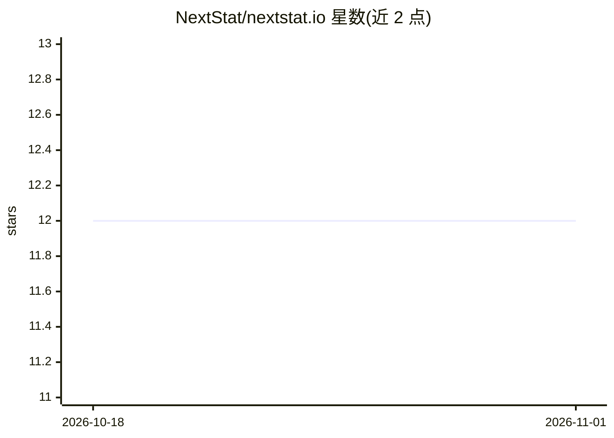

# NextStat/nextstat.io

⭐ 12 · Rust · AGPL-3.0 · 推送 2026-05-28 · [GitHub](https://github.com/NextStat/nextstat.io) · [官网](https://nextstat.io/) · 组织维护

**Rust 统计推断引擎：为 HEP/制药/计量经济学提供快速确定性建模**

用 Rust 编写的统计推断引擎，提供 Python、R、CLI、WASM 与自托管服务器多种绑定。功能覆盖高能物理 HistFactory 拟合与上限计算（兼容 pyhf JSON 工作区、无 ROOT C++ 依赖）、药代动力学 NLME（FOCE/SAEM/VPC、ICH M15 报告）、贝叶斯采样（NUTS/WALNUTS）、GLM、生存分析、计量经济学与时间序列。采用双执行路径（确定性参考路径 + SIMD/并行/可选 GPU 加速的生产路径），每个公开表面附带与参考实现的奇偶契约、支持矩阵与 CI 发布门禁。面向科学、制药与金融领域的统计建模用户。

## 筛选速览

| 维度 | 判定 | 备注 |
|---|---|---|
| AI 角色 | `ai-native` | 本体是模型或模型工具 |
| 许可风险 | `viral` | AGPL-3.0 |
| 部署形态 | `library` | 以包/库形式分发 |
| 模型依赖 | — | README 未给出锁定关系 |
| 硬件要求 | — | 无带数字的原话,不猜 |
| 安装摩擦 | `medium` | 含编译或系统依赖之一 |
| 成熟度 | — | 结构信号不足 |

## 能力要点

- HistFactory 拟合、假设检验、上限计算，直接读取 pyhf JSON 工作区且无 ROOT 依赖
- 每个公开表面附带奇偶契约、支持矩阵与 CI 发布门禁（141/141 HEP stable surfaces）
- 药代动力学 NLME 工作流与公开 IQ/OQ/PQ 验证协议、21 CFR Part 11 合规文档
- 多语言绑定：Python（pip）/R/CLI/WASM/自托管服务器

## 适用场景

- 在高能物理分析中对 HistFactory 工作区做拟合与上限计算
- 制药领域运行 PK/NLME 建模并生成受监管验证包
- 经济学面板数据与因果推断（DiD、IV/2SLS、AIPW）分析
- NUTS/WALNUTS 贝叶斯后验采样与时间序列建模

## 场景标签

 · 领域:科学计算/统计推断

## 证据(README 行号)

> L7: NextStat is a statistical inference engine built in Rust with bindings for
> L13: Beyond HEP, NextStat covers pharmacometrics (FOCE, SAEM, VPC, ICH M15),
> L103: - sample posteriors with NUTS, WALNUTS, and MAMS on the governed public CPU surface

## 星数曲线

2026-10-18 12 → 2026-11-01 12（+0）

---
*卡片 v1 · prompt 1.4 · 生成 2026-11-01 · 置信度 high · 依据 README sha `b7e387a6cd1c` · [字段定义](../../DATASET.md)*
