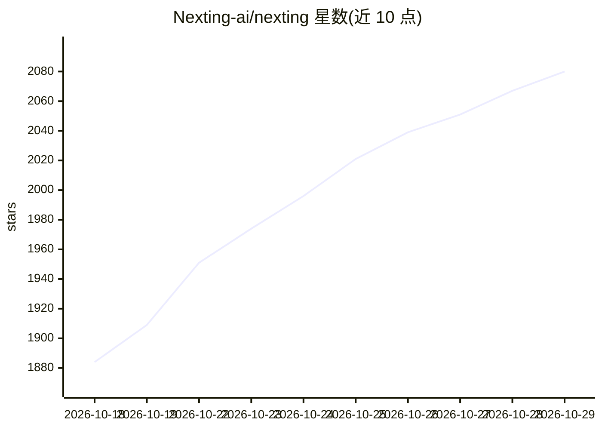

# Nexting-ai/nexting

⭐ 2,080 · C · MIT · 推送 2026-10-26 · [GitHub](https://github.com/Nexting-ai/nexting) · [官网](https://nexting.ai) · 组织维护

**可穿戴硬件+手机远程操控本机 AI agent 会话**

由 Nexting 公司提供的 AI agent 远程控制方案：包含 PIN 可穿戴硬件（$129，nRF52840、Zephyr 固件，开源 DIY 套件）、iOS 应用与云中继。通过 PIN 按键语音（BLE→iPhone STT→Cloud）向用户 Mac/Windows 上已运行的 Claude Code、Codex、Grok、Cursor、OpenClaw 或本地模型（Ollama/vLLM 等 OpenAI 兼容端点）发送任务，实时查看会话并远程驱动；iOS 应用将日历、提醒、HomeKit 等注册为 agent 可调用技能。支持可选端到端加密；另有 $29/月 托管云 agent 订阅 Nexting Pro。

## 筛选速览

| 维度 | 判定 | 备注 |
|---|---|---|
| AI 角色 | `ai-ecosystem` | LLM/agent 周边工具 |
| 许可风险 | `permissive` | MIT |
| 部署形态 | `library` | 以包/库形式分发 |
| 模型依赖 | local-ok | 支持本地模型 |
| 硬件要求 | — | 无带数字的原话,不猜 |
| 安装摩擦 | `low` | 无编译、无系统依赖或容器化 |
| 成熟度 | `idea` | |

## 能力要点

- 语音 3 秒派发任务至本机 Claude Code/Codex/Grok/Cursor 会话并实时查看
- MyHermes 模式可接入 Ollama/vLLM/LM Studio 等 OpenAI 兼容本地端点
- PIN 硬件完整开源：Zephyr 固件源码、3D 打印外壳、原理图（Co-Builder Edition）
- iOS 原生能力（日历/HomeKit/HealthKit 等）注册为 agent 可调用技能，支持可选端到端加密

## 适用场景

- 离开电脑时用可穿戴设备语音向自己的编程 agent 派发任务并收取结果
- 手机上实时查看并远程操控本机运行的多个 agent 会话
- 自建 OpenClaw 或本地模型端点并通过 Nexting 中继远程访问

## 场景标签

`AI 助手` · 领域:对话与助手

## 证据(README 行号)

> L17: You already have powerful agents — Claude Code, Codex, Grok, Cursor, OpenClaw — running on your computer. **Nexting
> L55: Nexting is a terminal, not a model. Connect the agent you already run:
> L64: |**MyHermes**|Any OpenAI-compatible local AI — Hermes Agent, Ollama, vLLM, LM Studio.|Free|

## 星数曲线

2026-10-18 1,884 → 2026-10-29 2,080（+196）

---
*卡片 v1 · prompt 1.4 · 生成 2026-10-21 · 置信度 high · 依据 README sha `56010f803ff3` · [字段定义](../../DATASET.md)*
