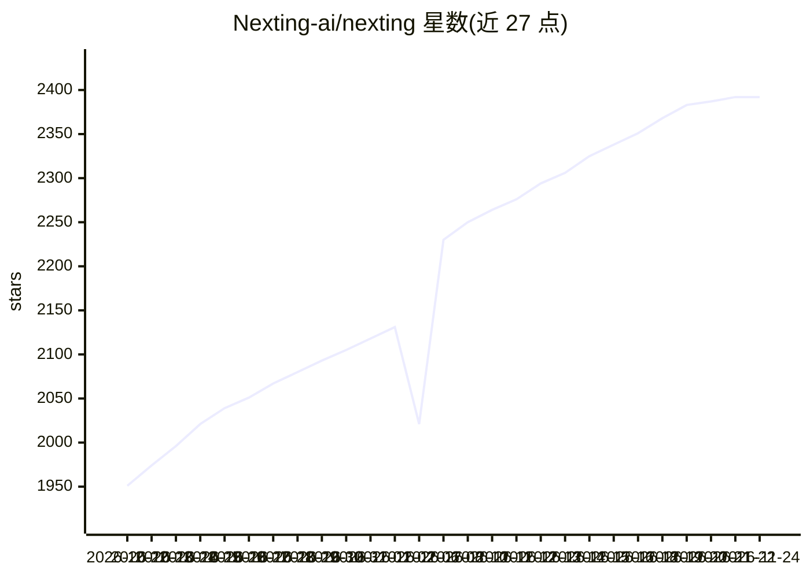

# Nexting-ai/nexting

⭐ — · [GitHub]() · 组织维护

**从手机远程查看与驱动本机 AI agent 会话的控制端**

Nexting 提供 iOS 应用与桥接工具，将 Mac/Windows 上运行的 Claude Code、Codex、Grok、Cursor、OpenClaw 会话镜像到手机，支持实时查看、发送任务与语音派发，agent 在后台执行并回推结果。接入方式包括各 agent 的一键安装脚本、OpenClaw 插件、以及通过 npm 包 nexting-hermes-bridge 指向任意 OpenAI 兼容本地端点；另提供托管模式 Nexting Pro（订阅制）。硬件为可选 DIY 项，PIN 设计文件在 hardware-opensource/ 目录。

## 筛选速览

| 维度 | 判定 | 备注 |
|---|---|---|
| AI 角色 | `ai-ecosystem` | LLM/agent 周边工具 |
| 许可风险 | `permissive` | — |
| 部署形态 | `library` | 以包/库形式分发 |
| 模型依赖 | local-ok | 支持本地模型 |
| 硬件要求 | — | 无带数字的原话,不猜 |
| 安装摩擦 | `low` | 无编译、无系统依赖或容器化 |
| 成熟度 | — | 结构信号不足 |

## 能力要点

-  attaches 到本机 agent 会话，实时查看、发送任务、远程驱动
- 语音一键派发（fire-and-forget），离线时 agent 仍执行并回推结果
- MyHermes 模式支持任意 OpenAI 兼容本地端点（Ollama/vLLM/LM Studio）
- PIN 为开源 DIY 硬件：Zephyr 固件源码、外壳文件与原理图公开

## 适用场景

- 在手机上远程查看并继续驱动电脑上的 Claude Code 会话
- 语音说出想法，让本地 agent 在后台执行任务
- 用 DIY 按钮（PIN）以按键说话方式向 agent 派发指令

## 场景标签

`编码 Agent` · 领域:编码与开发

## 证据(README 行号)

> L58: Nexting is a terminal, not a model. Connect the agent you already run:
> L67: |**MyHermes**|Any OpenAI-compatible local AI — Hermes Agent, Ollama, vLLM, LM Studio.|Free|
> L21: Nexting is software first: the apps and the agent connections are the product. Hardware is an optional way in.

## 星数曲线

2026-10-22 1,951 → 2026-11-24 2,392（+441）

---
*卡片 v1 · prompt 1.4 · 生成 2026-11-24 · 置信度 high · 依据 README sha `0de531d24427` · [字段定义](../../DATASET.md)*
