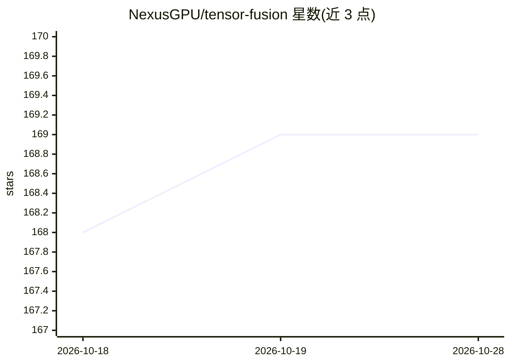

# NexusGPU/tensor-fusion

⭐ 169 · Go · Apache-2.0 · 推送 2026-10-26 · [GitHub](https://github.com/NexusGPU/tensor-fusion) · [官网](https://tensor-fusion.ai) · 组织维护 · 中文 README

**面向 Kubernetes 的 GPU 虚拟化与池化调度方案，给运维 GPU 集群的团队**

由 NexusGPU 团队开发的 GPU 虚拟化与池化系统：在 Kubernetes 中提供分数 GPU、远程 GPU 共享（GPU-over-IP）、GPU 优先调度、超卖与显存扩展。仓库构建 Controller（CRD 控制器、Pod 变异 webhook、GPU 感知调度器，可对接 Karpenter）与 Hypervisor（每 GPU 节点上的 DaemonSet，执行算力/显存限制）两个组件；工作负载通过 Pod 注解申请分数 GPU，隔离模式含 shared/soft/hard/partitioned。主仓库 Apache 2.0，但高级 GPU-over-IP 共享与 Enterprise 功能并非全部开源（组织 GPU 少于 10 台时免费使用），企业功能需付费授权；Windows 支持不开源。

## 筛选速览

| 维度 | 判定 | 备注 |
|---|---|---|
| AI 角色 | `ai-ecosystem` | LLM/agent 周边工具 |
| 许可风险 | `permissive` | Apache-2.0 |
| 部署形态 | `library` | 以包/库形式分发 |
| 模型依赖 | local-ok | 支持本地模型 |
| 硬件要求 | — | 无带数字的原话,不猜 |
| 安装摩擦 | `medium` | 含编译或系统依赖之一 |
| 成熟度 | — | 结构信号不足 |

## 能力要点

- 分数虚拟 GPU 与 GPU 超卖、显存扩展
- 远程 GPU 共享（以太网/InfiniBand，GPU-over-IP）
- GPU 优先调度与 Karpenter 集成的节点自动伸缩
- 兼容 PyTorch/TensorFlow/llama.cpp/vLLM/TensorRT/SGLang 等框架接入

## 适用场景

- 在 Kubernetes 集群中做 GPU 池化与细粒度分配
- 跨节点共享远程 GPU，提高集群利用率
- 按算力/显存精度调度并自动伸缩 GPU 节点
- 多租户 GPU 集群的用量计量与计费（企业功能）

## 场景标签

 · 领域:GPU 基础设施/Kubernetes

## 证据(README 行号)

> L20: Tensor Fusion is a state-of-the-art **GPU virtualization and pooling solution** designed to optimize GPU cluster ut
> L42: This repository builds the two components that run in your cluster:
> L47: A workload asks for a fraction of a GPU with Pod annotations. The webhook injects what the chosen isolation mode ne

## 星数曲线

2026-10-18 168 → 2026-10-28 169（+1）

---
*卡片 v1 · prompt 1.4 · 生成 2026-10-22 · 置信度 high · 依据 README sha `a908d8451496` · [字段定义](../../DATASET.md)*
