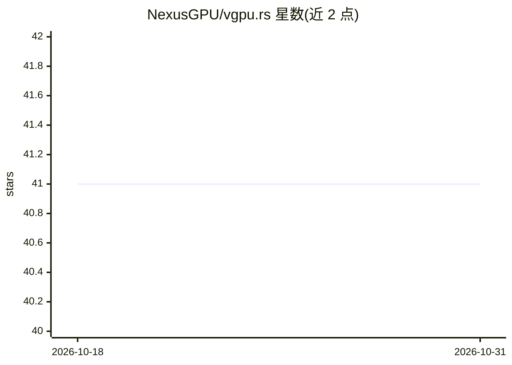

# NexusGPU/vgpu.rs

⭐ 41 · Rust · Apache-2.0 · 推送 2026-10-15 · [GitHub](https://github.com/NexusGPU/vgpu.rs) · [官网](https://tensor-fusion.ai) · 组织维护

**Rust 编写的 GPU 分片与 vGPU 虚拟化管理组件**

面向 Kubernetes 集群的 GPU 虚拟化与资源限制方案：Hypervisor 以 DaemonSet 部署在 GPU 节点上，通过 NVML 监控利用率并按配额调度（如加权轮询）；cuda-limiter 以 LD_PRELOAD 注入用户进程，用 frida-gum 拦截 CUDA/NVML API 调用，经 HTTP 长轮询或 SSE 接收调度指令，仅获准后放行 GPU 操作；共享内存广播全局利用率数据。基于 GaiaGPU 论文实现，支持多 Pod 共享物理 GPU 并按 Pod 隔离配额。安装方式为下载 GitHub Releases 二进制。

## 筛选速览

| 维度 | 判定 | 备注 |
|---|---|---|
| AI 角色 | `ai-ecosystem` | LLM/agent 周边工具 |
| 许可风险 | `permissive` | Apache-2.0 |
| 部署形态 | `desktop` | 安装包/桌面程序 |
| 模型依赖 | — | README 未给出锁定关系 |
| 硬件要求 | — | 无带数字的原话,不猜 |
| 安装摩擦 | `medium` | 含编译或系统依赖之一 |
| 成熟度 | — | 结构信号不足 |

## 能力要点

- Hypervisor DaemonSet 基于 NVML 监控并调度各 Pod 的 GPU 使用
- cuda-limiter 拦截 CUDA/NVML API 调用实施配额限制
- 共享内存广播节点级 GPU 利用率数据
- 设计基于 GaiaGPU（容器云 GPU 共享）论文

## 适用场景

- 多租户 Kubernetes 集群中让多个 Pod 共享同一块物理 GPU
- 按 Pod 精确限制 CUDA 工作负载的 GPU 用量
- 提升 GPU 资源利用率并做租户间隔离

## 场景标签

 · 领域:AI 基础设施/GPU 虚拟化

## 证据(README 行号)

> L9: vgpu.rs is a fractional GPU & vgpu-hypervisor implementation written in Rust.
> L103: This project provides a Kubernetes-based solution for GPU virtualization and resource limiting. Its primary goal i
> L108: * **Cuda-Limiter (SO Library)**: A dynamic library injected into the user application's process space via the `LD_

## 星数曲线

2026-10-18 41 → 2026-10-31 41（+0）

---
*卡片 v1 · prompt 1.4 · 生成 2026-10-25 · 置信度 high · 依据 README sha `a5764d3ba2fe` · [字段定义](../../DATASET.md)*
