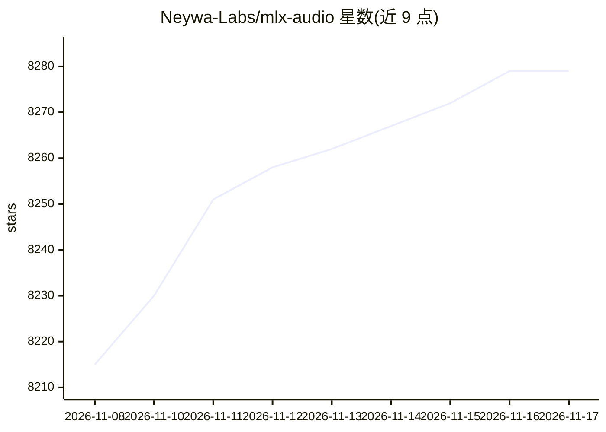

# Neywa-Labs/mlx-audio

⭐ 8,279 · Python · MIT · 推送 2026-11-16 · [GitHub](https://github.com/Neywa-Labs/mlx-audio) · [官网](https://www.neywalabs.ai) · 组织维护

**Apple Silicon 本地语音引擎：TTS/STT/STS/音乐生成一体化库**

基于 Apple MLX 框架构建的语音处理 Python 库，在 Mac 本地运行文本转语音、语音转文本、语音到语音、语音活动检测与音乐生成任务。收录数十种模型（Kokoro、Whisper、Qwen3-TTS、Nemotron 系列等），支持语音克隆、语速调节、多语言、3-8bit 量化、OpenAI 兼容 REST API、Web 界面与 Swift 包（iOS/macOS 集成）。提供命令行与 Python API，需 macOS + Apple Silicon + Python 3.11+。

## 筛选速览

| 维度 | 判定 | 备注 |
|---|---|---|
| AI 角色 | `ai-native` | 本体是模型或模型工具 |
| 许可风险 | `permissive` | MIT |
| 部署形态 | `library` | 以包/库形式分发 |
| 模型依赖 | — | README 未给出锁定关系 |
| 硬件要求 | — | 无带数字的原话,不猜 |
| 安装摩擦 | `medium` | 含编译或系统依赖之一 |
| 成熟度 | — | 结构信号不足 |

## 能力要点

- TTS/STT/STS/VAD/说话人分离/语音增强/音乐生成多任务覆盖
- 量化支持 3/4/6/8-bit，面向 Apple Silicon 优化推理
- OpenAI 兼容 REST API 与交互式 Web 界面
- Swift 包支持 iOS/macOS 集成

## 适用场景

- 在 Mac 本地离线完成文字转语音与语音转文字
- 为应用集成语音克隆、说话人分离或降噪能力
- 通过 OpenAI 兼容 API 在本地部署语音服务

## 场景标签

`语音合成` `语音识别` · 领域:内容生成

## 证据(README 行号)

> L5:  Run audio models on Apple Silicon. Text-to-speech, speech-to-text, speech-to-speech, and music generation. Built on
> L27: - Multiple model architectures for TTS, STT, STS, and music generation

## 星数曲线

2026-11-08 8,215 → 2026-11-17 8,279（+64）

---
*卡片 v1 · prompt 1.4 · 生成 2026-11-17 · 置信度 mid · 依据 README sha `e4004297c1f7` · [字段定义](../../DATASET.md)*
