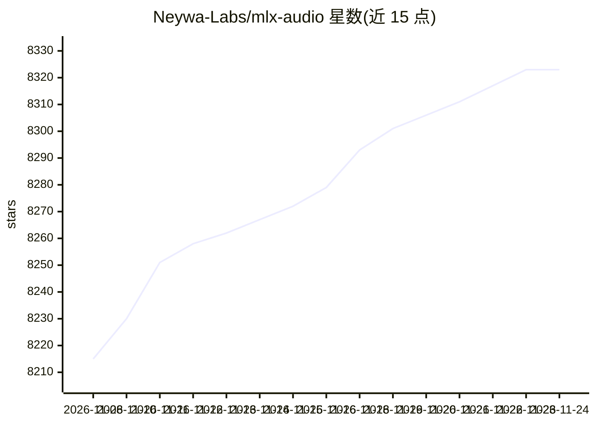

# Neywa-Labs/mlx-audio

⭐ 8,325 · Python · MIT · 推送 2026-11-23 · [GitHub](https://github.com/Neywa-Labs/mlx-audio) · [官网](https://www.neywalabs.ai) · 组织维护

**Apple Silicon 本地运行的 TTS/STT/STS 语音推理库**

基于 Apple MLX 框架的语音库，在 Apple Silicon 上本地运行文本转语音、语音转文本、语音转语音及音乐生成模型。收录数十种模型（Kokoro、Qwen3-TTS、Whisper、Parakeet、VAD 与说话人分离模型等），支持语音克隆、语速调节、多语言、3-8 比特量化，提供命令行、Python API、兼容 OpenAI 的 REST API、Web 界面及 Swift 包。安装方式为 pip/uv/git clone，要求 Python 3.11+，仅支持 macOS 与 Apple silicon。

## 筛选速览

| 维度 | 判定 | 备注 |
|---|---|---|
| AI 角色 | `ai-native` | 本体是模型或模型工具 |
| 许可风险 | `permissive` | MIT |
| 部署形态 | `library` | 以包/库形式分发 |
| 模型依赖 | — | README 未给出锁定关系 |
| 硬件要求 | — | 无带数字的原话,不猜 |
| 安装摩擦 | `medium` | 含编译或系统依赖之一 |
| 成熟度 | — | 结构信号不足 |

## 能力要点

- 在 Apple Silicon 上本地运行 TTS、STT、STS 与音乐生成模型
- 收录数十种模型，含语音克隆、多语言与流式输出
- 提供 OpenAI 兼容 REST API、Web 界面与 Swift 包
- 支持 3/4/6/8-bit 量化

## 适用场景

- 在 Mac 上本地生成或克隆语音
- 本地转录音频并做说话人分离
- 为 iOS/macOS 应用集成语音模型

## 场景标签

`语音合成` `语音识别` · 领域:内容生成

## 证据(README 行号)

> L5:  Run audio models on Apple Silicon. Text-to-speech, speech-to-text, speech-to-speech, and music generation. Built on
> L26: - Fast inference optimized for Apple Silicon (M series chips)
> L32: - OpenAI-compatible REST API

## 星数曲线

2026-11-08 8,215 → 2026-11-24 8,323（+108）

---
*卡片 v1 · prompt 1.4 · 生成 2026-11-22 · 置信度 mid · 依据 README sha `18a7572f765a` · [字段定义](../../DATASET.md)*
