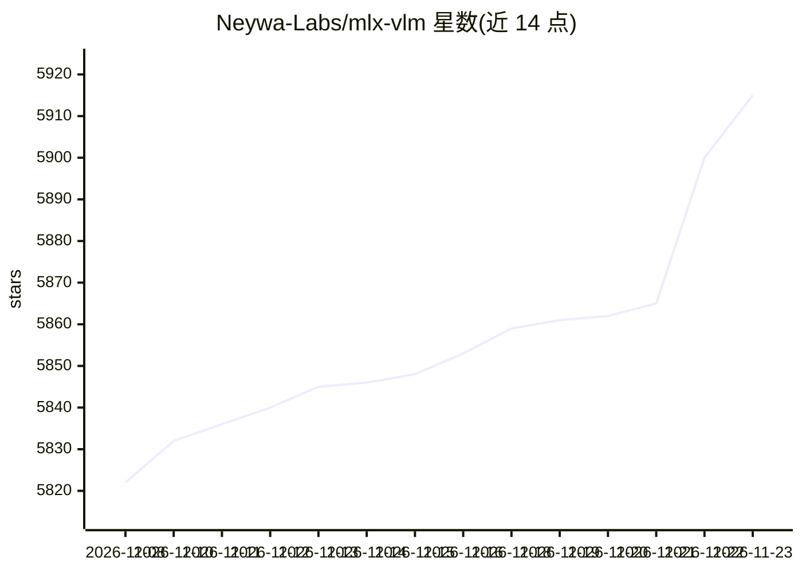

# Neywa-Labs/mlx-vlm

⭐ 5,915 · Python · MIT · 推送 2026-11-22 · [GitHub](https://github.com/Neywa-Labs/mlx-vlm) · [官网](https://neywa-labs.github.io/mlx-vlm/) · 组织维护

**在 Mac (Apple Silicon) 上本地运行与微调视觉语言模型的工具包**

基于 Apple MLX 框架的 Python 包，用于在 Mac 本地推理与微调视觉语言模型，支持文本、图像、视频、音频输入。提供 CLI（mlx_vlm.generate）、本地服务器（chat/messages/audio/image/cache/metrics 端点）、Gradio 聊天 UI（需额外依赖）、模型转换与量化（mlx_vlm.convert）、训练运行管理及推测解码（DFlash/EAGLE-3/MTP 三类 drafter）。MIT 许可，要求 Python 3.10+，仅面向 macOS Apple Silicon。

## 筛选速览

| 维度 | 判定 | 备注 |
|---|---|---|
| AI 角色 | `ai-ecosystem` | LLM/agent 周边工具 |
| 许可风险 | `permissive` | MIT |
| 部署形态 | `library` | 以包/库形式分发 |
| 模型依赖 | — | README 未给出锁定关系 |
| 硬件要求 | — | 无带数字的原话,不猜 |
| 安装摩擦 | `medium` | 含编译或系统依赖之一 |
| 成熟度 | — | 结构信号不足 |

## 能力要点

- CLI、本地服务器与 Python API 三种推理方式，支持文本/图像/音频输入与图像生成
- Hugging Face 模型转换与量化（RTN/AWQ、混合精度配方）
- 推测解码支持 dflash/eagle3/mtp 三类 drafter，本地服务器支持 thinking budget 控制
- 随仓库附带 agent-skills 包，可加载进 Claude Code/Codex/Gemini 等编码代理

## 适用场景

- 在 Mac 上本地运行多模态模型做图像理解与文本生成
- 将 Hugging Face 上的 VLM 转换为 MLX 量化格式后本地部署
- 在自己的数据上微调视觉语言模型
- 通过本地服务器端点把多模态模型接入应用

## 场景标签

`多模态` `微调` `模型量化` · 领域:感知与多模态

## 证据(README 行号)

> L5:  Run and fine-tune multimodal models on Apple Silicon. Text, images, video, and audio in — any out. Built on MLX.
> L81: The easiest way to get started is to install the `mlx-vlm` package using pip:

## 星数曲线

2026-11-08 5,822 → 2026-11-23 5,915（+93）

---
*卡片 v1 · prompt 1.4 · 生成 2026-11-23 · 置信度 high · 依据 README sha `f49912a4c1f8` · [字段定义](../../DATASET.md)*
