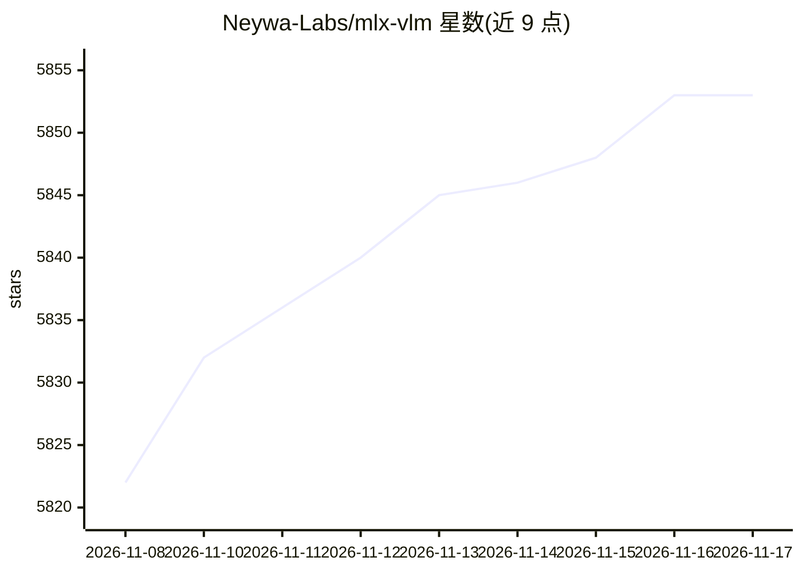

# Neywa-Labs/mlx-vlm

⭐ 5,853 · Python · MIT · 推送 2026-11-16 · [GitHub](https://github.com/Neywa-Labs/mlx-vlm) · [官网](https://neywa-labs.github.io/mlx-vlm/) · 组织维护

**在 Mac/Apple Silicon 上运行与微调视觉语言模型的 MLX 推理包**

基于 Apple MLX 框架构建的 Python 包，提供视觉语言模型（VLM）在 Apple Silicon 上的本地推理与微调能力：CLI 生成命令 mlx_vlm.generate、本地服务器 mlx_vlm.server、Hugging Face 模型转换与量化（mlx_vlm.convert，支持 RTN/AWQ、混合量化），并支持投机解码（DFlash/EAGLE-3/MTP 三类 drafter，实测最高 3.94× 加速）、thinking budget 控制、Gradio 聊天 UI（可选依赖）。仓库附 agent-skills 包供 Claude Code/Codex 等编码 agent 加载项目规范。面向在 Mac 上本地运行多模态模型的开发者，由 Neywa Labs 维护，MIT 许可。

## 筛选速览

| 维度 | 判定 | 备注 |
|---|---|---|
| AI 角色 | `ai-ecosystem` | LLM/agent 周边工具 |
| 许可风险 | `permissive` | MIT |
| 部署形态 | `library` | 以包/库形式分发 |
| 模型依赖 | — | README 未给出锁定关系 |
| 硬件要求 | — | 无带数字的原话,不猜 |
| 安装摩擦 | `medium` | 含编译或系统依赖之一 |
| 成熟度 | — | 结构信号不足 |

## 能力要点

- MLX 上的 VLM 推理与微调，覆盖文本/图像/视频/音频输入
- 模型转换与量化：RTN/AWQ、混合量化、4-bit 等 bits/group-size 配置
- 投机解码支持 DFlash/DFlash2/DSpark/EAGLE-3/MTP 多类 drafter
- 附 agent-skills 包（CLI 推理、服务器、转换量化、新增模型等 8 项技能）供编码 agent 加载

## 适用场景

- 在 Mac 上本地运行 Qwen、Gemma、MiniCPM 等视觉语言模型
- 将 Hugging Face 多模态模型转换为 MLX 格式并量化后部署
- 通过投机解码加速本地文本生成

## 场景标签

`推理引擎` `微调` `模型量化` `多模态` · 领域:感知与多模态

## 证据(README 行号)

> L5:  Run and fine-tune multimodal models on Apple Silicon. Text, images, video, and audio in — any out. Built on MLX.
> L78: The easiest way to get started is to install the `mlx-vlm` package using pip:

## 星数曲线

2026-11-08 5,822 → 2026-11-17 5,853（+31）

---
*卡片 v1 · prompt 1.4 · 生成 2026-11-17 · 置信度 high · 依据 README sha `e02870a735fe` · [字段定义](../../DATASET.md)*
