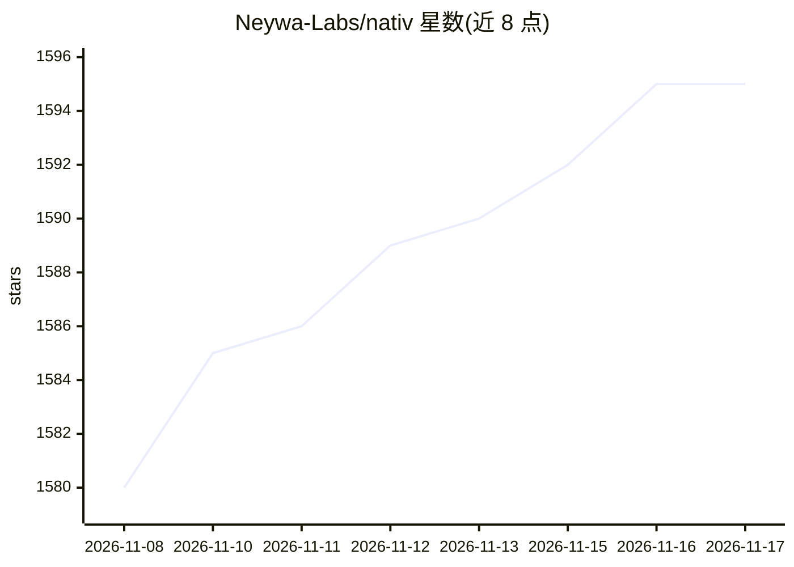

# Neywa-Labs/nativ

⭐ 1,595 · Swift · MIT · 推送 2026-11-16 · [GitHub](https://github.com/Neywa-Labs/nativ) · [官网](https://runnativ.ai) · 组织维护

**macOS 本地 AI 应用：在 Apple Silicon 上离线运行开源模型**

Nativ 是开源的 Mac 本地 AI 应用，基于 SwiftUI 与捆绑的 mlx-vlm 服务器，在 Apple Silicon 上运行 MLX 格式的开源模型，推理全部在本地完成。功能包括流式对话与视觉、本地图像生成、模型库管理、语音听写扩展、MCP 服务器接入、定时任务，以及 OpenAI/Anthropic 兼容的本地 API 服务器，可供 Codex、Claude Code、VS Code 等编码工具接入。要求 macOS 26+ 与 Apple Silicon，通过 DMG 或 Homebrew 安装，也可从源码构建（需 Xcode 与 xcodegen）。

## 筛选速览

| 维度 | 判定 | 备注 |
|---|---|---|
| AI 角色 | `ai-native` | 本体是模型或模型工具 |
| 许可风险 | `permissive` | MIT |
| 部署形态 | `library` | 以包/库形式分发 |
| 模型依赖 | — | README 未给出锁定关系 |
| 硬件要求 | — | 无带数字的原话,不猜 |
| 安装摩擦 | `medium` | 含编译或系统依赖之一 |
| 成熟度 | — | 结构信号不足 |

## 能力要点

- 在 Apple Silicon 上本地运行 MLX 模型，推理不出本机
- 提供 OpenAI 与 Anthropic 兼容的本地 API 服务器
- 模型库支持从 Hugging Face 下载并给出内存适配警告
- 本地语音听写、图像生成、MCP 工具接入与编码工具集成

## 适用场景

- 在 Mac 上离线进行聊天、视觉理解与图像生成
- 为编码工具（Claude Code、Codex、VS Code 等）提供本地推理后端
- 管理和监控本地模型与系统性能

## 场景标签

`图像生成` `多模态` `聊天机器人` · 领域:对话与助手

## 证据(README 行号)

> L5:  Nativ is an open-source local AI app for Mac.
> L6:  It runs open AI models on Apple Silicon, and nothing leaves your Mac.

## 星数曲线

2026-11-08 1,580 → 2026-11-17 1,595（+15）

---
*卡片 v1 · prompt 1.4 · 生成 2026-11-17 · 置信度 mid · 依据 README sha `df8bee11f013` · [字段定义](../../DATASET.md)*
