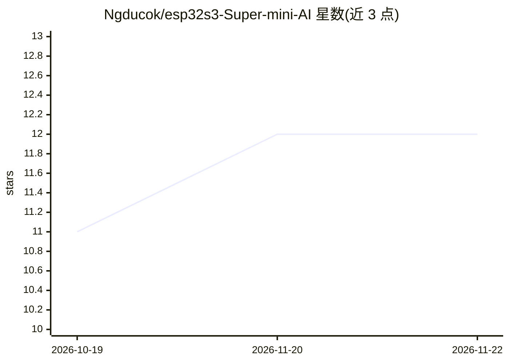

# Ngducok/esp32s3-Super-mini-AI

⭐ 12 · C++ · MIT · 推送 2026-08-21 · [GitHub](https://github.com/Ngducok/esp32s3-Super-mini-AI) · 个人维护

**在 ESP32-S3 上零云依赖本地运行生成式微型 Transformer**

将一个约 119K 参数（INT8，3 层）的自回归生成语言模型完整部署在 ESP32-S3 Super Mini 板上，仅使用 384KB 内部 SRAM、无需外部 PSRAM。内置 SoftAP WiFi 热点与内存中 HTTP 服务器，从 Flash 直接提供聊天网页界面；同时支持 USB 串口对话。关键机制包括 128 位 SIMD GEMV 内核、Flash 查找表快速数学函数、INT4 分组量化与滑动窗口环形缓冲 KV-Cache。烧录方式为 ESP-IDF 构建或 Arduino IDE 上传。

## 筛选速览

| 维度 | 判定 | 备注 |
|---|---|---|
| AI 角色 | `ai-native` | 本体是模型或模型工具 |
| 许可风险 | `permissive` | MIT |
| 部署形态 | `None` |  |
| 模型依赖 | — | README 未给出锁定关系 |
| 硬件要求 | — | 无带数字的原话,不猜 |
| 安装摩擦 | `low` | 无编译、无系统依赖或容器化 |
| 成熟度 | — | 结构信号不足 |

## 能力要点

- 无需外部 PSRAM，仅在 384KB 内部 SRAM 内运行生成式模型
- SoftAP WiFi 热点 + 内存 Web 聊天界面与 USB 串口两种交互方式
- SIMD GEMV、INT4 量化、FastMath LUT 等端侧优化机制
- 滑动窗口环形缓冲 KV-Cache 支持连续生成

## 适用场景

- 在无外网的嵌入式设备上体验本地文本生成
- 作为 ESP32-S3 端侧 AI 部署的教学参考工程
- 在超低成本开发板上探索神经网络推理的内存边界

## 场景标签

`模型量化` · 领域:训练与推理

## 证据(README 行号)

> L11: This is an on-device autoregressive generative language model (Micro-Transformer) running entirely locally on an ES
> L13: The system pairs the Transformer decoder engine with an independent SoftAP WiFi hotspot and an in-memory HTTP web s

## 星数曲线

2026-10-19 11 → 2026-11-22 12（+1）

---
*卡片 v1 · prompt 1.4 · 生成 2026-11-19 · 置信度 high · 依据 README sha `0a110118c231` · [字段定义](../../DATASET.md)*
