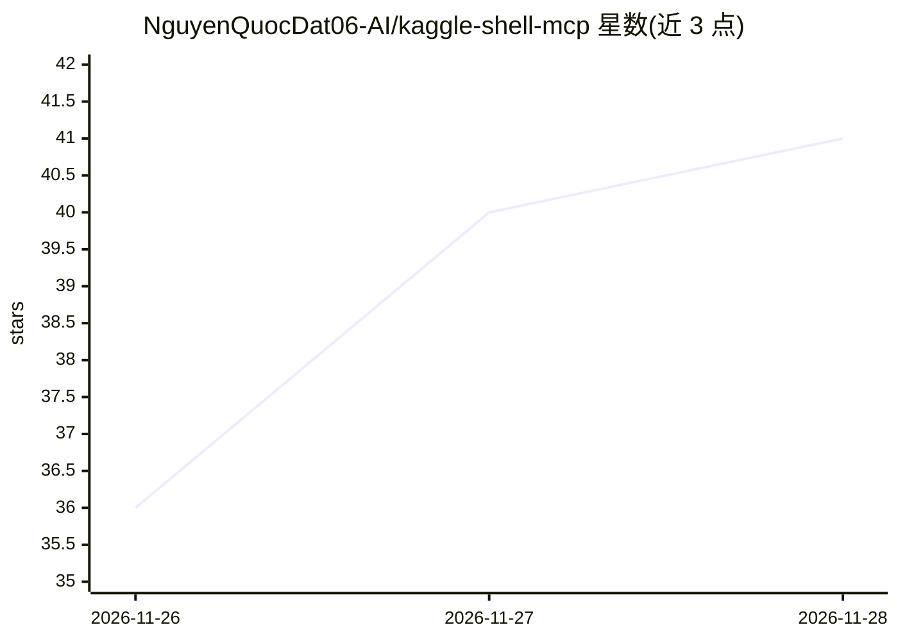

# NguyenQuocDat06-AI/kaggle-shell-mcp

⭐ 41 · Rust · MIT · 推送 2026-11-27 · [GitHub](https://github.com/NguyenQuocDat06-AI/kaggle-shell-mcp) · 个人维护

**让 AI Agent 通过 MCP 把 Kaggle 免费 GPU 用作远程终端**

一个 MCP 服务器兼 CLI 工具（kgsh），将 Kaggle 免费 GPU 会话封装为可编程的远程终端与后台作业运行器：提供 12 个 MCP 工具，覆盖启动/查询/停止并行会话、持久 PTY 执行命令、脱离式后台作业管理、文件同步、离线竞赛模式的 wheelhouse 打包与日志流式读取。凭据仅需 Kaggle API token，无需 ngrok 或 VPN；内置 11h35m SIGTERM 安全排水与 12h 会话链式续跑机制。面向 AI Agent 与开发者，MIT 许可，Python 3.11+。

## 筛选速览

| 维度 | 判定 | 备注 |
|---|---|---|
| AI 角色 | `ai-ecosystem` | LLM/agent 周边工具 |
| 许可风险 | `permissive` | MIT |
| 部署形态 | `library` | 以包/库形式分发 |
| 模型依赖 | — | README 未给出锁定关系 |
| 硬件要求 | — | 无带数字的原话,不猜 |
| 安装摩擦 | `medium` | 含编译或系统依赖之一 |
| 成熟度 | — | 结构信号不足 |

## 能力要点

- 12 个 MCP 工具：会话管理、PTY 执行、后台作业、文件同步、离线批量运行
- 支持最多 2 个并行 Kaggle GPU 会话，按 gpu_ids 固定任务（4×T4=60GB VRAM）
- 离线竞赛模式：打包 Linux wheels 并经 Host SSE 流式读取日志
- 11h35m 安全排水信号与 chain_previous_output 会话链式续跑

## 适用场景

- 让 AI Agent 在 Kaggle 免费 GPU 上远程执行训练脚本
- 在 Kaggle 高端硬件（L4x4/RTX Pro 6000）上离线跑竞赛任务并实时看日志
- 链式运行超过 12 小时的训练作业

## 场景标签

 · 领域:开发工具/计算资源接入

## 证据(README 行号)

> L17: **`kaggle-shell-mcp`** (CLI: **`kgsh`**) gives AI Agents and developers a unified compute bridge:
> L71: ## MCP Tools Reference (12 Tools)

## 星数曲线

2026-11-26 36 → 2026-11-28 41（+5）

---
*卡片 v1 · prompt 1.4 · 生成 2026-11-26 · 置信度 high · 依据 README sha `4177b6badf1d` · [字段定义](../../DATASET.md)*
