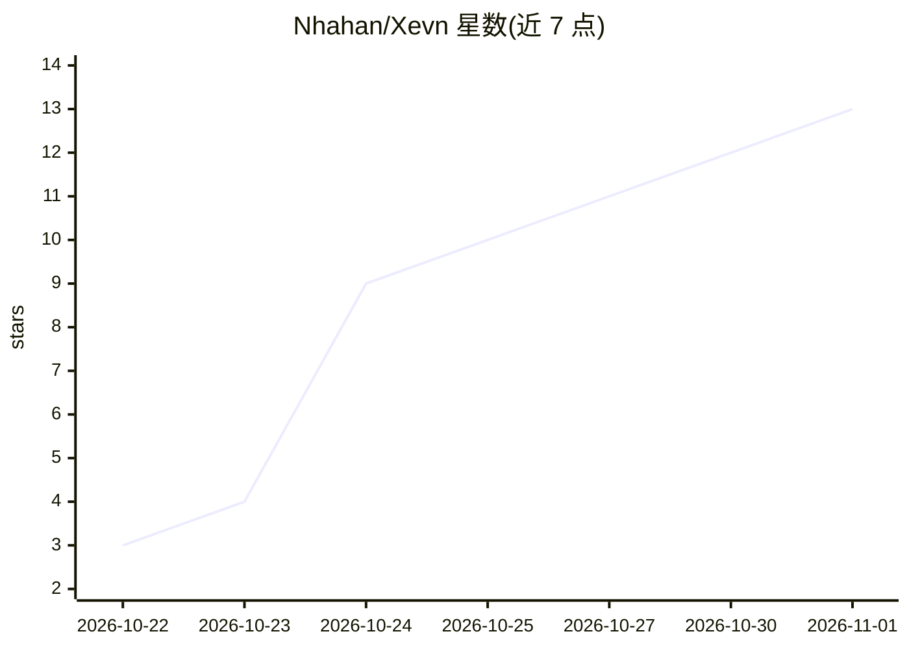

# Nhahan/Xevn

⭐ 13 · Apache-2.0 · 推送 2026-10-23 · [GitHub](https://github.com/Nhahan/Xevn) · [官网](https://nhahan.github.io/Xevn/) · 个人维护

**面向韩语的 4B 决策模型：选择题/判断/评分的概率输出**

Xevn 是基于 Qwen3.5-4B 训练的 4B 决策模型，面向韩语的理解、知识与判断任务。遵循 Jev 决策格式：读入问题与选项后为每个选项返回概率，无文本生成，单次请求仅需一次前向传播。支持三类任务（choice 最多 26 选项、noul 是非判断、score 等级评分）。提供 16-bit 到 3-bit 的 MLX 量化权重及 GGUF 格式，另有 PyTorch/Transformers 16-bit 版本。明确声明不是聊天或文本生成模型，面向韩语调优，英语可用但非重点。

## 筛选速览

| 维度 | 判定 | 备注 |
|---|---|---|
| AI 角色 | `ai-native` | 本体是模型或模型工具 |
| 许可风险 | `permissive` | Apache-2.0 |
| 部署形态 | `None` |  |
| 模型依赖 | local-ok | 支持本地模型 |
| 硬件要求 | — | 无带数字的原话,不猜 |
| 安装摩擦 | `low` | 无编译、无系统依赖或容器化 |
| 成熟度 | — | 结构信号不足 |

## 能力要点

- 无文本生成，单请求一次前向传播输出各选项概率
- 三种任务类型：choice/noul/score
- 提供 16-bit 至 3-bit 的 MLX 量化与 GGUF 格式权重
- 韩英双语基准测试数据（KoBEST、MMLU 等）

## 适用场景

- 韩语选择题、是非判断与评分任务的批量决策
- 对延迟敏感的单次概率判定场景（p50 56-156ms 级）
- 在 Apple Silicon 上以 MLX 量化格式本地运行模型

## 场景标签

 · 领域:NLP/决策模型

## 证据(README 行号)

> L7: Xevn is a 4B decision model built for Korean, trained for Korean understanding, knowledge, and judgment.
> L9: Xevn follows the Jev decision format. It reads a question and its options once and returns the answer together with 
> L145: Xevn is built for decisions: classification, multiple choice, yes/no judgments, and rating. It is not a chat or te

## 星数曲线

2026-10-22 3 → 2026-11-01 13（+10）

---
*卡片 v1 · prompt 1.4 · 生成 2026-10-31 · 置信度 high · 依据 README sha `b87abd56c135` · [字段定义](../../DATASET.md)*
