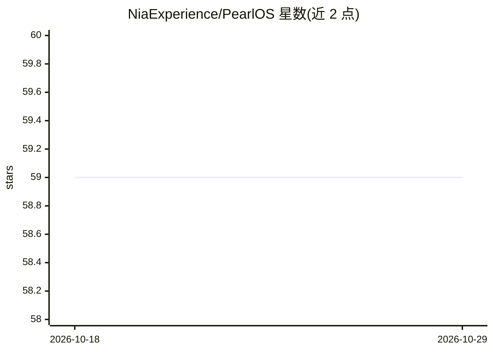

# NiaExperience/PearlOS

⭐ 59 · TypeScript · NOASSERTION · 推送 2026-06-25 · [GitHub](https://github.com/NiaExperience/PearlOS) · [官网](https://pearlos.org/) · 组织维护

**语音优先的浏览器桌面环境：AI 伙伴 Pearl 实时控制整个界面**

PearlOS 是运行于浏览器的桌面环境，由名为 Pearl 的 AI 伙伴驱动：通过 Pipecat + Daily.co WebRTC 语音管线实时对话，Pearl 以 50+ 工具直接操作窗口、内置应用（Wonder Canvas、Markdown 笔记、YouTube、配乐、精灵动画）与系统状态，README 描述其为'AI 即 UI'而非内嵌助手的界面。由三个服务组成（Next.js 界面、语音 bot、GraphQL mesh），提供交互式与一键式 bash 安装脚本，需自备 Deepgram、Daily.co、LLM 提供商与 PocketTTS 的 API key，许可为源码可得非商业（PSAL-NC）。

## 筛选速览

| 维度 | 判定 | 备注 |
|---|---|---|
| AI 角色 | `ai-native` | 本体是模型或模型工具 |
| 许可风险 | `none` | NOASSERTION |
| 部署形态 | `library` | 以包/库形式分发 |
| 模型依赖 | — | README 未给出锁定关系 |
| 硬件要求 | — | 无带数字的原话,不猜 |
| 安装摩擦 | `low` | 无编译、无系统依赖或容器化 |
| 成熟度 | — | 结构信号不足 |

## 能力要点

- WebRTC 全双工语音管线（Pipecat 编排 VAD/打断/轮次管理）
- 50+ 工具使 Pearl 具备对桌面环境的操作能力（窗口管理/应用控制/记忆）
- 浏览器内窗口化桌面：可拖拽窗口、任务栏与 7 个内置应用
- 交互式安装向导自动处理依赖、.env、数据库种子与 bot 配置

## 适用场景

- 用语音与 AI 伙伴对话并让其代为操作整个桌面环境
- 在浏览器中运行带窗口化应用的个人 AI 桌面（含手机/平板）
- 让 AI 生成视觉内容到 Wonder Canvas、管理笔记与背景音乐

## 场景标签

`语音 Agent` `GUI 自动化` · 领域:效率与自动化

## 证据(README 行号)

> L10: PearlOS is a browser-based, voice-first desktop environment powered by an AI companion named Pearl. Pearl has full 
> L76: - **Voice-first AI companion.** Pearl listens and responds in real time using a full WebRTC voice pipeline. No butt

## 星数曲线

2026-10-18 59 → 2026-10-29 59（+0）

---
*卡片 v1 · prompt 1.4 · 生成 2026-10-24 · 置信度 mid · 依据 README sha `346d13a33f5a` · [字段定义](../../DATASET.md)*
