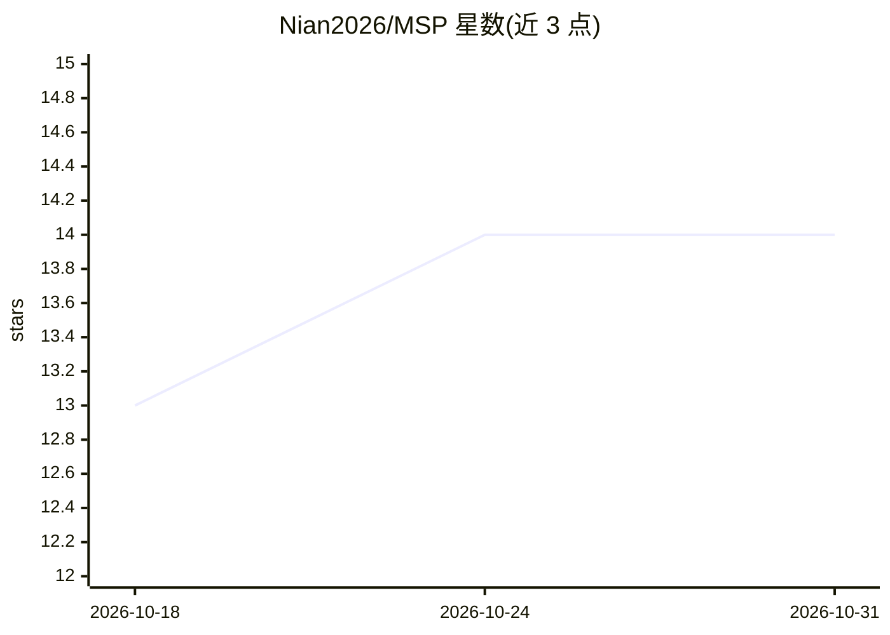

# Nian2026/MSP

⭐ 14 · JavaScript · Apache-2.0 · 推送 2026-07-23 · [GitHub](https://github.com/Nian2026/MSP) · 个人维护

**面向 AI agent 的应用内命令运行时协议与 Swift SDK**

Model Shell Protocol（MSP）定义应用内部的操作系统语义层：把应用数据、平台权限、领域对象与产品动作投影为文件、命令、流、脚本、策略与审计记录，供模型以 shell 语法操作。运行时自实现 shell 解析、命令分发、WorkspaceFS 路径与策略检查，不暴露宿主 /bin/sh；应用可注册领域命令与核心命令包共享管道、重定向、退出码等组合机制。当前含 Swift 实现与 PhotoSorter（iOS 照片库）和 Playground 两个演示，仍处于活跃开发阶段；配套产品 ReadOS 未开源。

## 筛选速览

| 维度 | 判定 | 备注 |
|---|---|---|
| AI 角色 | `ai-ecosystem` | LLM/agent 周边工具 |
| 许可风险 | `permissive` | Apache-2.0 |
| 部署形态 | `None` |  |
| 模型依赖 | — | README 未给出锁定关系 |
| 硬件要求 | — | 无带数字的原话,不猜 |
| 安装摩擦 | `medium` | 含编译或系统依赖之一 |
| 成熟度 | `idea` | |

## 能力要点

- 应用自有 shell 运行时：自实现解析器/命令分发/WorkspaceFS/策略与审计，不暴露宿主 shell
- 应用可注册领域命令，与 POSIX 风格核心命令包通过管道、重定向、脚本组合
- 跨平台适配目标覆盖 iOS/iPadOS/macOS/visionOS/Windows/Android/Web
- Swift 实现含 ModelShellProxy、WorkspaceFS、手写 shell 解析与 POSIX 类命令包

## 适用场景

- 在我的应用内为 AI agent 提供受策略约束的命令工作区
- 让 agent 以 shell 组合方式操作应用数据（如整理照片库、编辑文档）
- 为 agent-native 产品建立可审计的执行环境

## 场景标签

`Agent 框架` · 领域:Agent 开发

## 证据(README 行号)

> L8: MSP is the operating-system semantics layer inside an application: a runtime
> L97: MSP is not a library feature. It is the software boundary between AI agents and

## 星数曲线

2026-10-18 13 → 2026-10-31 14（+1）

---
*卡片 v1 · prompt 1.4 · 生成 2026-10-31 · 置信度 high · 依据 README sha `dacd24ea3981` · [字段定义](../../DATASET.md)*
