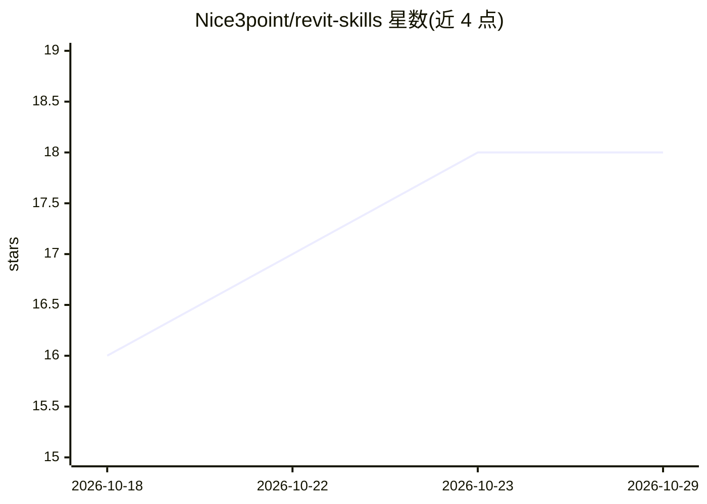

# Nice3point/revit-skills

⭐ 18 · C# · MIT · 推送 2026-10-07 · [GitHub](https://github.com/Nice3point/revit-skills) · 个人维护

**面向 Revit 插件开发的 AI agent 技能插件集（8 个插件）**

为构建 Autodesk Revit 插件的开发者提供的 Agent Skills 集合：含 revit-api、revit-ui、revit-solution、revit-testing、revit-benchmarking 五个 Revit 领域插件，以及 dotnet、dotnet-advanced、dotnet-solution 三个 .NET 通用插件，覆盖 API 自动化、UI 构建、测试与基准测试。按需安装插件而非整套安装，支持 Claude Code、Codex、VS Code（预览）、Cursor 四种环境的插件市场，也可手动复制技能目录到项目内。

## 筛选速览

| 维度 | 判定 | 备注 |
|---|---|---|
| AI 角色 | `ai-knowledge` | 知识聚合/清单类 |
| 许可风险 | `permissive` | MIT |
| 部署形态 | `None` |  |
| 模型依赖 | — | README 未给出锁定关系 |
| 硬件要求 | — | 无带数字的原话,不猜 |
| 安装摩擦 | `medium` | 含编译或系统依赖之一 |
| 成熟度 | `idea` | |

## 能力要点

- 8 个插件按 Revit API/UI/测试/基准测试与 .NET 通用主题拆分
- 支持 Claude Code 与 Codex 的 marketplace 安装、更新流程
- VS Code（预览）与 Cursor 亦有接入说明
- 提供手动复制到 .claude/skills/ 或 .agents/skills/ 的本地安装方式

## 适用场景

- 让 AI 编码助手按 Revit API 规范编写插件代码
- 为 .NET 项目结构与架构设计提供编码指引
- 在 Claude Code/Codex 中安装并更新 Revit 开发技能插件

## 场景标签

`编码 Agent` · 领域:编码与开发

## 证据(README 行号)

> L6: This repository contains focused Agent Skills for building Autodesk Revit add-ins. Install only the plugins that mat
> L10: |Plugin|Description|
> L12: |revit-api|Build Revit model automation with the Revit API.|

## 星数曲线

2026-10-18 16 → 2026-10-29 18（+2）

---
*卡片 v1 · prompt 1.4 · 生成 2026-10-29 · 置信度 high · 依据 README sha `4afd334e2f92` · [字段定义](../../DATASET.md)*
