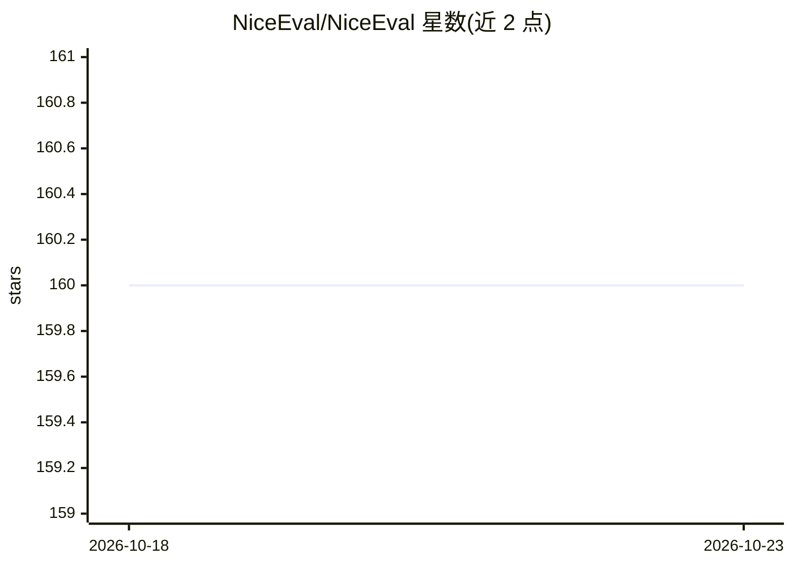

# NiceEval/NiceEval

⭐ 160 · TypeScript · 推送 2026-10-22 · [GitHub](https://github.com/NiceEval/NiceEval) · [官网](https://www.niceeval.com/) · 组织维护 · 中文 README

**用 TypeScript 写类单元测试的 LLM agent 评测框架**

面向 agent 与 LLM 应用的评测框架：用类型化 TypeScript 描述“何为正确”（工具调用、回复内容、测试通过、世界状态），连接被测系统，重复运行并打分，保留每次运行的对话、工具调用、文件变更、耗时与成本供对比。Eval 用例与被测系统（Experiment）分离，可用同一组用例对比模型、prompt 版本或扩展。可在 Docker 或云端沙箱中运行编码 agent 并以项目自身测试评分；全部在本机与 CI 运行，无需账号。提供 Claude Code、Codex、LangGraph 等官方适配器。

## 筛选速览

| 维度 | 判定 | 备注 |
|---|---|---|
| AI 角色 | `ai-ecosystem` | LLM/agent 周边工具 |
| 许可风险 | `none` | — |
| 部署形态 | `None` |  |
| 模型依赖 | locked-api |  |
| 硬件要求 | — | 无带数字的原话,不猜 |
| 安装摩擦 | `low` | 无编译、无系统依赖或容器化 |
| 成熟度 | — | 结构信号不足 |

## 能力要点

- 类型化 TypeScript 编写 eval，断言工具调用、回复内容与文件变更
- Eval 用例与 Experiment 分离，支持对比模型、prompt 与扩展
- 编码 agent 在 Docker/云端沙箱运行，用项目自身测试评分
- 保留每次运行的对话、工具调用、成本记录供调查

## 适用场景

- 改 prompt 或换模型后重跑 eval 检查是否回归
- 对比两个模型或 prompt 版本在同一组用例上的表现
- 衡量 Claude Code 的 Skill/Plugin 是否真的提升 agent 表现
- 在 CI 中低于分数阈值时阻止变更合并

## 场景标签

`模型评测` · 领域:评测与运维

## 证据(README 行号)

> L16: NiceEval replaces guesswork with evidence. Its main focus is agents, but it can evaluate any LLM-powered applicatio
> L74: DeepEval is a mature Python evaluation framework with a rich metric library. NiceEval makes different tradeoffs:
> L78: - **Score in real environments**: coding agents run in Docker or cloud Sandboxes and are scored using the project's

## 星数曲线

2026-10-18 160 → 2026-10-23 160（+0）

---
*卡片 v1 · prompt 1.4 · 生成 2026-10-22 · 置信度 high · 依据 README sha `802944fc13fd` · [字段定义](../../DATASET.md)*
