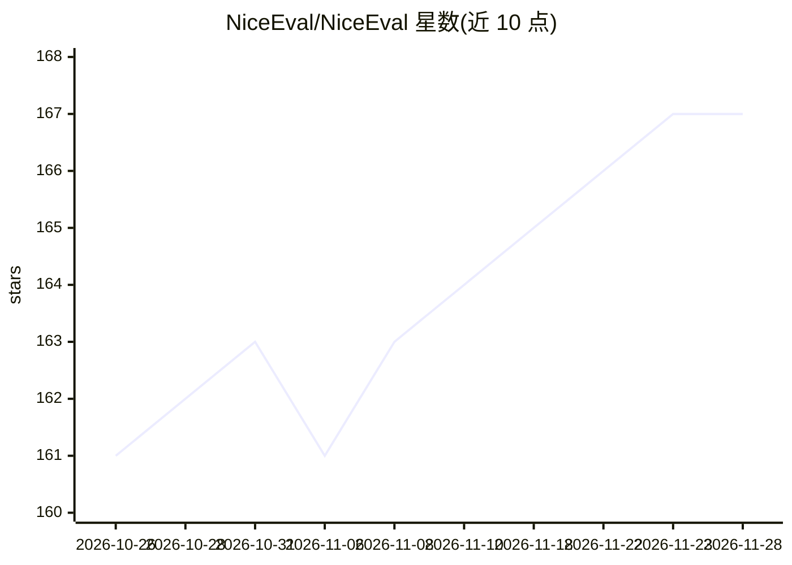

# NiceEval/NiceEval

⭐ 167 · TypeScript · 推送 2026-11-27 · [GitHub](https://github.com/NiceEval/NiceEval) · [官网](https://www.niceeval.com/) · 个人维护 · 中文 README

**给 agent 开发者写单元测试式评测并用其对比实验**

TypeScript 编写的 agent 评测框架：用 defineEval/defineJudge 以单元测试风格描述“什么算正确”，通过 Adapter 连接被测系统，重复运行并记录每轮对话、工具调用、文件改动、耗时与成本。评测用例与被测对象（Experiment）分离，可用同一组用例对比不同模型或提示词版本；编码类 agent 在 Docker 或云沙箱中运行并用项目自身测试打分。全部在本地或 CI 运行，无需注册账号；提供 pnpm CLI 与浏览器结果查看。

## 筛选速览

| 维度 | 判定 | 备注 |
|---|---|---|
| AI 角色 | `ai-ecosystem` | LLM/agent 周边工具 |
| 许可风险 | `none` | — |
| 部署形态 | `None` |  |
| 模型依赖 | — | README 未给出锁定关系 |
| 硬件要求 | — | 无带数字的原话,不猜 |
| 安装摩擦 | `low` | 无编译、无系统依赖或容器化 |
| 成熟度 | `idea` | |

## 能力要点

- 评测用例与被测对象分离，同一用例可直接对比模型/提示词/扩展
- 对过程断言：多轮对话、工具调用、文件改动，无需先备好黄金数据集
- 编码类 agent 在 Docker/云沙箱运行，用项目自身测试与文件改动打分
- 可接入 CI，得分低于阈值即阻断变更

## 适用场景

- 改完提示词或换模型后回归验证通过率是否下降
- 判断给 Claude Code 写的 Skill/Plugin 是否真的有效
- 评测 LLM 游戏或 AI 社交应用的发帖、回复与世界状态一致性
- 把真实使用中的失败案例沉淀为新评测用例

## 场景标签

`模型评测` · 领域:评测与运维

## 证据(README 行号)

> L16: NiceEval replaces guesswork with evidence. Its main focus is agents, but it can evaluate any LLM-powered applicatio
> L57: **Your own AI applications.** Whether built with AI SDK, LangGraph, Pi, or your own agent loop, and regardless of i

## 星数曲线

2026-10-26 161 → 2026-11-28 167（+6）

---
*卡片 v1 · prompt 1.4 · 生成 2026-11-27 · 置信度 high · 依据 README sha `71c3f691c7f4` · [字段定义](../../DATASET.md)*
