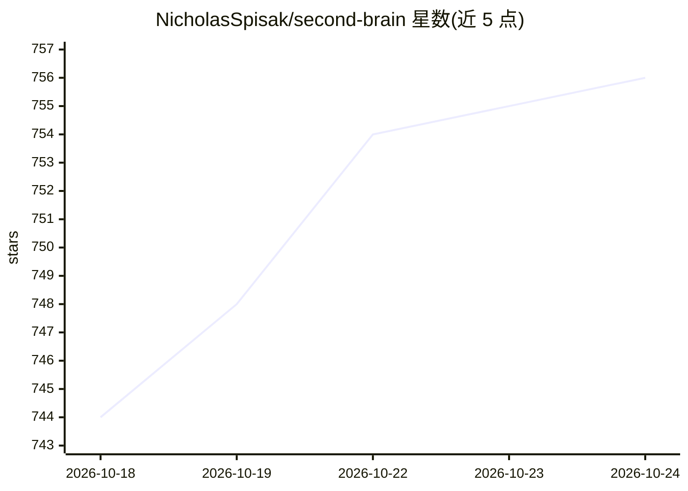

# NicholasSpisak/second-brain

⭐ 756 · Shell · 推送 2026-04-07 · [GitHub](https://github.com/NicholasSpisak/second-brain) · 个人维护

**LLM 维护的个人知识库技能包：原始资料自动编成 Obsidian wiki**

基于 Andrej Karpathy 的 LLM Wiki 模式，以 Agent Skills 形式分发的个人知识库方案：用户将文章、论文、笔记、转录等原始资料放入 raw/ 目录，AI 编码代理读取后生成结构化 wiki 页面、交叉引用与索引，在 Obsidian 中浏览与查询。提供 4 个技能：向导式建库（/second-brain）、资料摄取（/second-brain-ingest）、问答（/second-brain-query）与一致性检查（/second-brain-lint），通过 npx skills add 安装到 Claude Code、Codex、Cursor、Gemini CLI 等 40+ 代理，可选安装 summarize、qmd、agent-browser 等工具。

## 筛选速览

| 维度 | 判定 | 备注 |
|---|---|---|
| AI 角色 | `ai-native` | 本体是模型或模型工具 |
| 许可风险 | `none` | — |
| 部署形态 | `library` | 以包/库形式分发 |
| 模型依赖 | — | README 未给出锁定关系 |
| 硬件要求 | — | 无带数字的原话,不猜 |
| 安装摩擦 | `low` | 无编译、无系统依赖或容器化 |
| 成熟度 | — | 结构信号不足 |

## 能力要点

- 4 个技能覆盖建库、摄取、问答与 lint 健康检查
- LLM 读取 raw/ 目录生成 wiki 页面、wikilinks 与索引
- 兼容 Claude Code、Codex、Cursor、Gemini CLI 等 40+ 代理，多代理可共管同一 vault
- 向导幂等，不覆盖已有文件；支持多代理配置

## 适用场景

- 把收藏的文章、论文、笔记自动整理成可浏览的 Obsidian wiki
- 在个人知识库上通过 /second-brain-query 提问
- 定期 lint 检查索引一致性与失效 wikilinks

## 场景标签

`知识库管理` `文档问答` · 领域:知识与检索

## 证据(README 行号)

> L3: An LLM-maintained personal knowledge base built on the LLM Wiki pattern. Drop raw sources into a folder, let the LLM
> L9: You feed raw material (articles, papers, notes, transcripts) into a `raw/` folder. The LLM reads everything, writes 

## 星数曲线

2026-10-18 744 → 2026-10-24 756（+12）

---
*卡片 v1 · prompt 1.4 · 生成 2026-10-21 · 置信度 high · 依据 README sha `94b1cdbc421b` · [字段定义](../../DATASET.md)*
