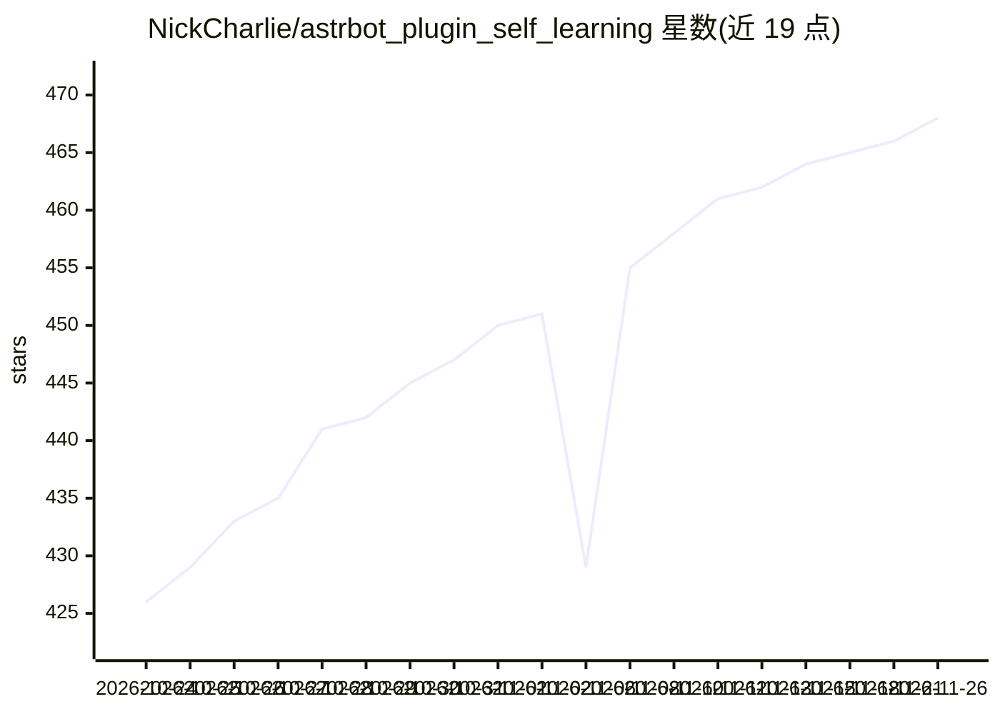

# NickCharlie/astrbot_plugin_self_learning

⭐ 468 · Python · AGPL-3.0 · 推送 2026-11-24 · [GitHub](https://github.com/NickCharlie/astrbot_plugin_self_learning) · 个人维护 · 中文 README

**AstrBot 插件：让聊天机器人从群聊中学习风格与黑话**

以 AstrBot 插件形式安装，在消息进入、回复发送后、下一次 LLM 请求前三个钩子位采集群聊数据，经审查链路批准后注入表达样本、黑话解释、社交关系、好感度与记忆图谱到 LLM 请求上下文。学习结果需人工批准/拒绝/回滚，支持 SQLite/MySQL/PostgreSQL 三种数据库与自动建表迁移。要求已在运行的 AstrBot 框架，pip 依赖需在 WebUI 中手动确认安装，Provider 未配置时 LLM 功能降级。

## 筛选速览

| 维度 | 判定 | 备注 |
|---|---|---|
| AI 角色 | `ai-ecosystem` | LLM/agent 周边工具 |
| 许可风险 | `viral` | AGPL-3.0 |
| 部署形态 | `library` | 以包/库形式分发 |
| 模型依赖 | — | README 未给出锁定关系 |
| 硬件要求 | — | 无带数字的原话,不猜 |
| 安装摩擦 | `low` | 无编译、无系统依赖或容器化 |
| 成熟度 | — | 结构信号不足 |

## 能力要点

- 学习结果经审查队列批准后才应用，支持批量操作与回滚
- 在 on_llm_request 阶段注入社交、黑话、记忆与 few-shot 上下文
- WebUI Dashboard 提供 14 个路由的设置、审查与监控界面
- 支持 SQLite、MySQL、PostgreSQL 及自动建表与列级迁移

## 适用场景

- 让群聊机器人学习群内表达方式和黑话并自然回复
- 管理 Bot 与群成员的社交关系和好感度
- 通过审查队列控制人格演化和学习内容的采纳

## 场景标签

`聊天机器人` `Agent 记忆` · 领域:Agent 开发

## 证据(README 行号)

> L5: 让 AstrBot 在群聊中持续采集、学习、审查并注入上下文，使 Bot 逐步具备表达风格、群组黑话、社交关系、长期记忆和人格演化能力。
> L54: |LLM 请求注入|在 `on_llm_request` 阶段注入社交、黑话、记忆、few-shot 和临时人格增量|
> L58: 插件不会直接替换 AstrBot 的回复逻辑。它在消息进入、Bot 回复发送后、下一次 LLM 请求前这三个位置增强 AstrBot。

## 星数曲线

2026-10-24 426 → 2026-11-26 468（+42）

---
*卡片 v1 · prompt 1.4 · 生成 2026-11-26 · 置信度 mid · 依据 README sha `6e3d9dfa653f` · [字段定义](../../DATASET.md)*
