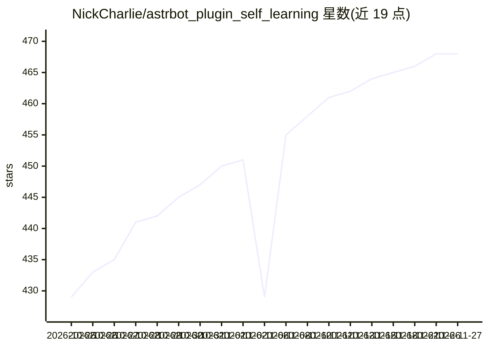

# NickCharlie/astrbot_plugin_self_learning

⭐ 468 · Python · AGPL-3.0 · 推送 2026-11-26 · [GitHub](https://github.com/NickCharlie/astrbot_plugin_self_learning) · 个人维护 · 中文 README

**让 AstrBot 群聊机器人自主学习风格/黑话/关系的插件**

AstrBot 框架的插件，在消息进入、回复发送后、下次 LLM 请求前三个钩子位置增强机器人：从群聊上下文提取表达模式与黑话含义，学习结果先经审查队列（批准/拒绝/回滚/自动应用）再注入 LLM 请求，同时维护社交关系、好感度、记忆图与知识图谱。提供独立 WebUI 与 AstrBot 内嵌面板共 14 个路由的管理界面，默认使用 PostgreSQL，可切换 SQLite 或 MySQL，自动建表与列级迁移。Provider 未配置时 LLM 功能降级。

## 筛选速览

| 维度 | 判定 | 备注 |
|---|---|---|
| AI 角色 | `ai-enhanced` | 去掉 AI 部分产品仍成立 |
| 许可风险 | `viral` | AGPL-3.0 |
| 部署形态 | `library` | 以包/库形式分发 |
| 模型依赖 | — | README 未给出锁定关系 |
| 硬件要求 | — | 无带数字的原话,不猜 |
| 安装摩擦 | `low` | 无编译、无系统依赖或容器化 |
| 成熟度 | — | 结构信号不足 |

## 能力要点

- 学习结果先经审查队列，支持批准、拒绝、删除、回滚与自动应用策略
- 在 on_llm_request 阶段注入社交、黑话、记忆、few-shot 与临时人格增量
- 独立 WebUI 与 AstrBot 内嵌面板共 14 个路由管理界面
- 支持 PostgreSQL、SQLite、MySQL 三种数据库并自动建表

## 适用场景

- 让群聊机器人学习群友的表达方式和黑话
- 管理机器人的人格演化并逐条审查学习结果
- 记录群成员互动关系与好感度

## 场景标签

`聊天机器人` `知识图谱` · 领域:对话与助手

## 证据(README 行号)

> L5: 让 AstrBot 在群聊中持续采集、学习、审查并注入上下文，使 Bot 逐步具备表达风格、群组黑话、社交关系、长期记忆和人格演化能力。
> L58: 插件不会直接替换 AstrBot 的回复逻辑。它在消息进入、Bot 回复发送后、下一次 LLM 请求前这三个位置增强 AstrBot。

## 星数曲线

2026-10-25 429 → 2026-11-27 468（+39）

---
*卡片 v1 · prompt 1.4 · 生成 2026-11-27 · 置信度 mid · 依据 README sha `c32d50686f6d` · [字段定义](../../DATASET.md)*
