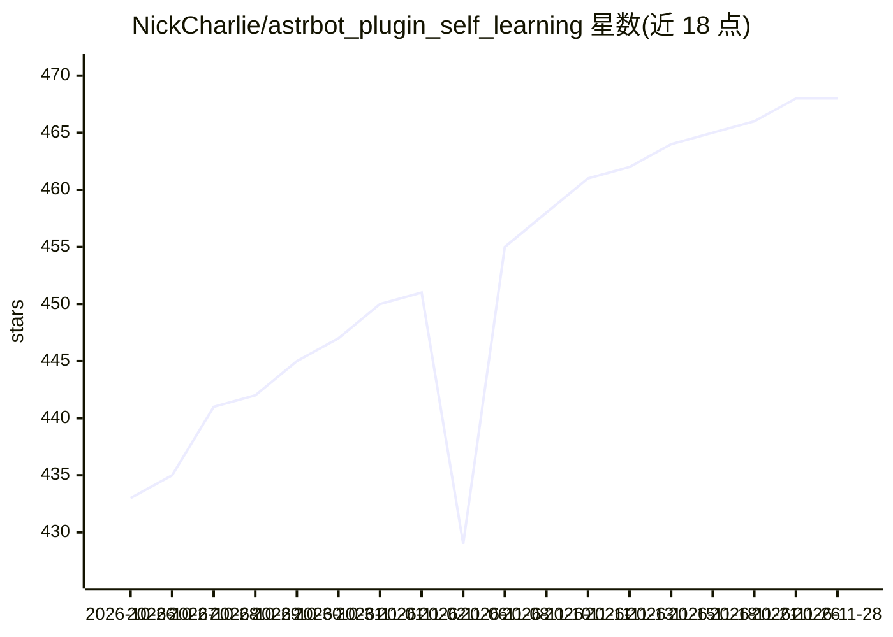

# NickCharlie/astrbot_plugin_self_learning

⭐ 468 · Python · AGPL-3.0 · 推送 2026-11-27 · [GitHub](https://github.com/NickCharlie/astrbot_plugin_self_learning) · 个人维护 · 中文 README

**AstrBot 聊天机器人的自主学习插件：学风格、黑话、社交与人格**

作为 AstrBot 插件运行，在消息进入、Bot 回复后、下一次 LLM 请求前三个钩子位置采集群聊数据，经审查链路（批准/拒绝/回滚）后注入表达样本、黑话解释、社交关系、记忆图谱与 few-shot 内容，使 Bot 逐步具备表达风格与人格演化。依赖 AstrBot 框架与用户配置的 Provider；Provider 未配置时 LLM 功能降级。依赖需经 WebUI 手动确认安装，数据库默认 PostgreSQL，可切换 SQLite/MySQL。

## 筛选速览

| 维度 | 判定 | 备注 |
|---|---|---|
| AI 角色 | `ai-native` | 本体是模型或模型工具 |
| 许可风险 | `viral` | AGPL-3.0 |
| 部署形态 | `library` | 以包/库形式分发 |
| 模型依赖 | — | README 未给出锁定关系 |
| 硬件要求 | — | 无带数字的原话,不猜 |
| 安装摩擦 | `low` | 无编译、无系统依赖或容器化 |
| 成熟度 | — | 结构信号不足 |

## 能力要点

- 学习结果先经审查队列（批准/拒绝/删除/回滚）再应用
- 在 on_llm_request 阶段注入社交、黑话、记忆与 few-shot
- 支持 SQLite、MySQL、PostgreSQL，自动建表与列级迁移
- 提供独立 WebUI 与 AstrBot 内嵌页两套管理界面（14 个路由）

## 适用场景

- 让群聊机器人学习群友表达方式和群组黑话
- 管理 Bot 的社交关系、好感度与情绪状态
- 通过审查队列人工把关人格演化内容
- 与 LivingMemory、Group Chat Plus 等插件组合使用

## 场景标签

`聊天机器人` `Agent 记忆` · 领域:Agent 开发

## 证据(README 行号)

> L5: 让 AstrBot 在群聊中持续采集、学习、审查并注入上下文，使 Bot 逐步具备表达风格、群组黑话、社交关系、长期记忆和人格演化能力。
> L54: |LLM 请求注入|在 `on_llm_request` 阶段注入社交、黑话、记忆、few-shot 和临时人格增量|

## 星数曲线

2026-10-26 433 → 2026-11-28 468（+35）

---
*卡片 v1 · prompt 1.4 · 生成 2026-11-28 · 置信度 mid · 依据 README sha `b326e5f4af15` · [字段定义](../../DATASET.md)*
