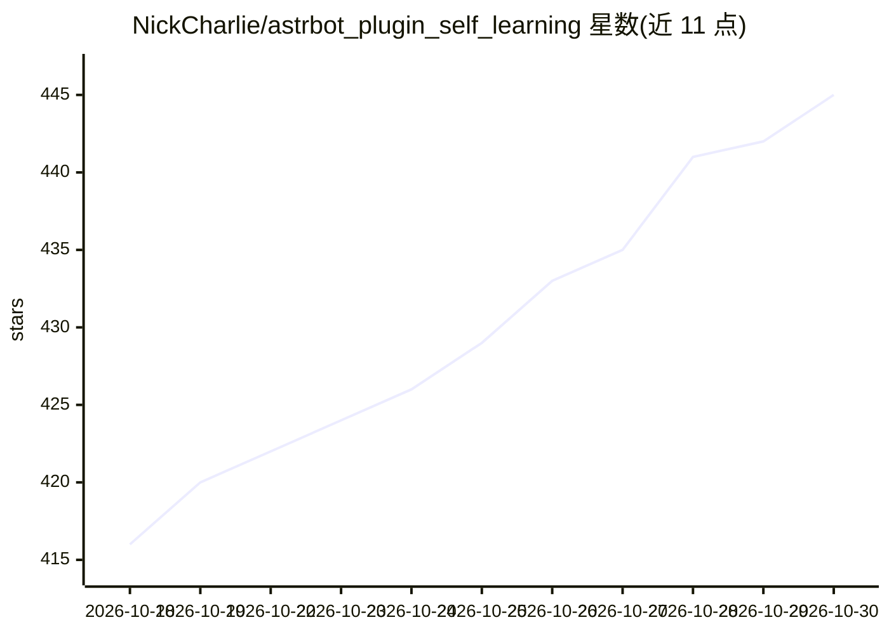

# NickCharlie/astrbot_plugin_self_learning

⭐ 445 · Python · AGPL-3.0 · 推送 2026-10-29 · [GitHub](https://github.com/NickCharlie/astrbot_plugin_self_learning) · 个人维护 · 中文 README

**AstrBot 自主学习插件：让聊天 Bot 学习对话风格与群组黑话**

面向 AstrBot 聊天机器人框架的插件：在消息进入、Bot 回复后、LLM 请求前三个钩子位置增强 AstrBot。功能包括从 user→bot 对话对提取表达模式、群组黑话推断与注入、人格演化审查（批准/拒绝/回滚）、社交关系与好感度记录、记忆图与知识图谱、WebUI Dashboard 管理审查与监控。支持 SQLite/MySQL/PostgreSQL，默认 PostgreSQL 需建库建表权限。安装方式为 git clone 到插件目录，pip 依赖需在 WebUI 中手动确认安装，Provider 未配置时 LLM 功能降级。

## 筛选速览

| 维度 | 判定 | 备注 |
|---|---|---|
| AI 角色 | `ai-ecosystem` | LLM/agent 周边工具 |
| 许可风险 | `viral` | AGPL-3.0 |
| 部署形态 | `library` | 以包/库形式分发 |
| 模型依赖 | — | README 未给出锁定关系 |
| 硬件要求 | — | 无带数字的原话,不猜 |
| 安装摩擦 | `low` | 无编译、无系统依赖或容器化 |
| 成熟度 | — | 结构信号不足 |

## 能力要点

- 对话风格学习：从 user→bot 对话对提取表达模式与 few-shot
- 群组黑话学习：高频词统计预筛+上下文推断，LLM 请求前注入解释
- 人格演化审查链路：批准、拒绝、删除、回滚与自动应用策略
- WebUI Dashboard 提供设置、审查、图谱、日志与模型调用监控

## 适用场景

- 让 QQ 群聊 Bot 逐步学习目标用户的说话风格与群内黑话
- 通过 WebUI 审查和回滚 Bot 的人格学习结果
- 为 Bot 维护社交关系、好感度与长期记忆图谱

## 场景标签

`聊天机器人` `Agent 记忆` `知识图谱` · 领域:Agent 开发

## 证据(README 行号)

> L5: 让 AstrBot 在群聊中持续采集、学习、审查并注入上下文，使 Bot 逐步具备表达风格、群组黑话、社交关系、长期记忆和人格演化能力。
> L58: 插件不会直接替换 AstrBot 的回复逻辑。它在消息进入、Bot 回复发送后、下一次 LLM 请求前这三个位置增强 AstrBot。

## 星数曲线

2026-10-18 416 → 2026-10-30 445（+29）

---
*卡片 v1 · prompt 1.4 · 生成 2026-10-21 · 置信度 mid · 依据 README sha `9d68f6b9f802` · [字段定义](../../DATASET.md)*
