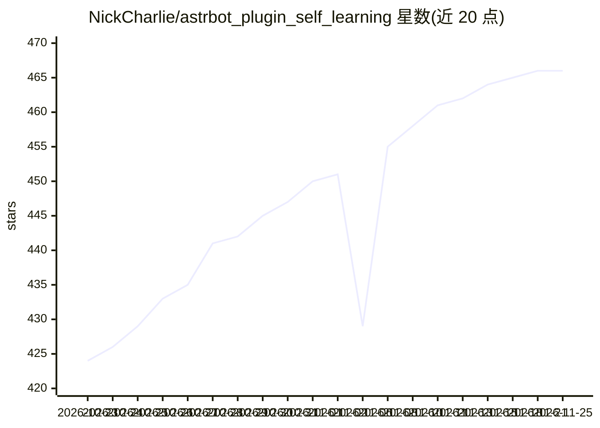

# NickCharlie/astrbot_plugin_self_learning

⭐ 466 · Python · AGPL-3.0 · 推送 2026-11-14 · [GitHub](https://github.com/NickCharlie/astrbot_plugin_self_learning) · 个人维护 · 中文 README

**AstrBot 聊天机器人插件：自主学习对话风格与群组黑话**

面向 AstrBot 框架的自学习插件，在消息进入、Bot 回复后、下一次 LLM 请求前三个位置增强宿主：从群聊上下文提取表达模式与黑话含义，经审查链路（批准/拒绝/回滚/自动应用）后注入 few-shot、社交关系、记忆与临时人格增量；另提供好感度与心理状态跟踪、记忆/知识图谱、14 路由的 WebUI Dashboard 与管理员命令。依赖 WebUI 手动确认安装 pip 依赖，默认 PostgreSQL 并可回退 SQLite/MySQL。

## 筛选速览

| 维度 | 判定 | 备注 |
|---|---|---|
| AI 角色 | `ai-enhanced` | 去掉 AI 部分产品仍成立 |
| 许可风险 | `viral` | AGPL-3.0 |
| 部署形态 | `library` | 以包/库形式分发 |
| 模型依赖 | — | README 未给出锁定关系 |
| 硬件要求 | — | 无带数字的原话,不猜 |
| 安装摩擦 | `low` | 无编译、无系统依赖或容器化 |
| 成熟度 | — | 结构信号不足 |

## 能力要点

- 学习结果先经审查链路，支持批准、拒绝、删除、回滚和自动应用策略
- 在 on_llm_request 阶段注入社交、黑话、记忆、few-shot 和人格增量
- WebUI Dashboard 覆盖全量设置、审查队列、图谱与指标监控
- 支持 SQLite、MySQL、PostgreSQL 多数据库，含自动建表和列级迁移

## 适用场景

- 让群聊 Bot 学习群友的表达风格和黑话并自然对话
- 管理 Bot 的社交关系、好感度与情绪状态
- 通过审查队列控制人格演化内容上线

## 场景标签

`聊天机器人` `知识图谱` `Agent 记忆` · 领域:Agent 开发

## 证据(README 行号)

> L5: 让 AstrBot 在群聊中持续采集、学习、审查并注入上下文，使 Bot 逐步具备表达风格、群组黑话、社交关系、长期记忆和人格演化能力。
> L54: |LLM 请求注入|在 `on_llm_request` 阶段注入社交、黑话、记忆、few-shot 和临时人格增量|
> L58: 插件不会直接替换 AstrBot 的回复逻辑。它在消息进入、Bot 回复发送后、下一次 LLM 请求前这三个位置增强 AstrBot。

## 星数曲线

2026-10-23 424 → 2026-11-25 466（+42）

---
*卡片 v1 · prompt 1.4 · 生成 2026-11-25 · 置信度 mid · 依据 README sha `31d9f81fdf21` · [字段定义](../../DATASET.md)*
