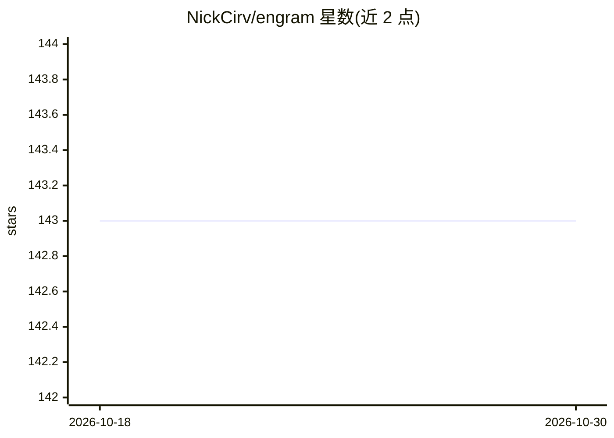

# NickCirv/engram

⭐ 143 · TypeScript · Apache-2.0 · 推送 2026-10-21 · [GitHub](https://github.com/NickCirv/engram) · [官网](https://github.com/NickCirv/engram) · 个人维护

**给 AI 编码代理的本地代码图谱与上下文工具包**

面向 AI 编码代理的本地结构化代码图谱与上下文工具包：索引源码实体、Git 关系与选定的项目记忆，通过 CLI、agent hooks、MCP 和带鉴权的本地 dashboard 提供聚焦上下文，用于在读取完整文件前查找相关代码、查看调用关系、把记录过的错误带入后续会话。图谱存储于项目本地 SQLite（sql.js），HTTP 服务绑定 127.0.0.1 并要求 bearer token。文档明确说明系统不保证完全离线（npm 更新检查、Context7、可选 MCP/插件），token 缩减数字需自行复现验证。需 Node >=20，源码构建运行，Apache-2.0 许可。

## 筛选速览

| 维度 | 判定 | 备注 |
|---|---|---|
| AI 角色 | `ai-ecosystem` | LLM/agent 周边工具 |
| 许可风险 | `permissive` | Apache-2.0 |
| 部署形态 | `None` |  |
| 模型依赖 | — | README 未给出锁定关系 |
| 硬件要求 | — | 无带数字的原话,不猜 |
| 安装摩擦 | `low` | 无编译、无系统依赖或容器化 |
| 成熟度 | — | 结构信号不足 |

## 能力要点

- 索引源码实体、Git 关系与错误/会话信息到本地 SQLite 图谱
- 通过 CLI、agent hooks、MCP 与带鉴权本地 dashboard 提供上下文
- 支持 8 种 IDE/代理集成文档生成（gen-mdc/gen-aider/gen-windsurfrules/gen-ccs 等）
- HTTP 服务绑定 127.0.0.1，校验 Host/Origin 并要求 bearer token

## 适用场景

- AI 编码代理读取文件前先查询相关代码与调用关系以节省上下文
- 把上一会话记录的错误带入后续编码会话
- 为 Cursor/Aider/Windsurf 等工具生成代理配置文档

## 场景标签

`Agent 记忆` `知识图谱` · 领域:Agent 开发

## 证据(README 行号)

> L5: A local structural code graph and context toolkit for AI coding agents. Engram indexes source entities, Git relation
> L40: Source miners extract entities, references, Git co-change and selected mistake/session information. The graph store

## 星数曲线

2026-10-18 143 → 2026-10-30 143（+0）

---
*卡片 v1 · prompt 1.4 · 生成 2026-10-22 · 置信度 high · 依据 README sha `fa02fe434667` · [字段定义](../../DATASET.md)*
