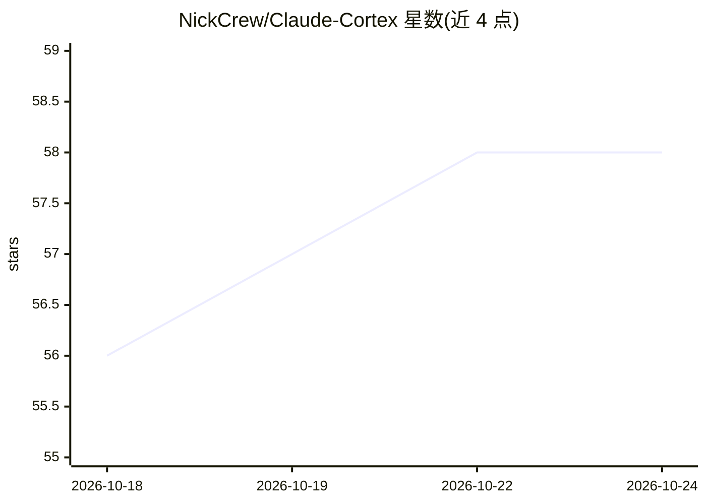

# NickCrew/Claude-Cortex

⭐ 58 · Python · MIT · 推送 2026-06-29 · [GitHub](https://github.com/NickCrew/Claude-Cortex) · [官网](https://cortex.atlascrew.dev/) · 组织维护

**协调多模型 AI agent 的开发编排框架**

面向 Claude Code、Codex、Gemini 的多模型开发编排框架：强制跨模型独立评审（写代码的 agent 不评审自己的代码），评审按 Claude→不同模型族→同模型新上下文的顺序路由；代码变更经实现→独立评审→修复→复审、测试编写、Lint 三层渐进式质量门（含熔断与人工升级）。附带技能推荐流水线、agents/skills/rules/hooks 资产与 Python CLI/TUI。提供 Homebrew 与 pip/pipx 安装。

## 筛选速览

| 维度 | 判定 | 备注 |
|---|---|---|
| AI 角色 | `ai-ecosystem` | LLM/agent 周边工具 |
| 许可风险 | `permissive` | MIT |
| 部署形态 | `library` | 以包/库形式分发 |
| 模型依赖 | locked-api |  |
| 硬件要求 | — | 无带数字的原话,不猜 |
| 安装摩擦 | `low` | 无编译、无系统依赖或容器化 |
| 成熟度 | — | 结构信号不足 |

## 能力要点

- 跨模型独立评审路由与回退链
- 三层质量门循环（代码/测试/Lint）含熔断与人工升级
- 技能推荐双层流水线（关键词匹配+可选语义匹配）
- Python CLI 与 TUI，附带 cortex-minimal 精简命令面

## 适用场景

- 在 Claude Code/Codex/Gemini 多模型协作中强制独立代码评审
- 为 AI 辅助开发建立可审计的结构化工作流
- 自动审计测试覆盖缺口并补写测试

## 场景标签

`Agent 框架` `代码审查` `编码 Agent` · 领域:Agent 开发

## 证据(README 行号)

> L8:  Multi-model development orchestration for Claude Code, Codex, and Gemini.
> L14: Cortex is a development orchestration framework that coordinates AI agents across model providers. It enforces qual
> L20: Cortex's core principle: **the agent that writes the code never reviews it.** When Codex implements a feature, the 

## 星数曲线

2026-10-18 56 → 2026-10-24 58（+2）

---
*卡片 v1 · prompt 1.4 · 生成 2026-10-24 · 置信度 high · 依据 README sha `ba93dfec8fb4` · [字段定义](../../DATASET.md)*
