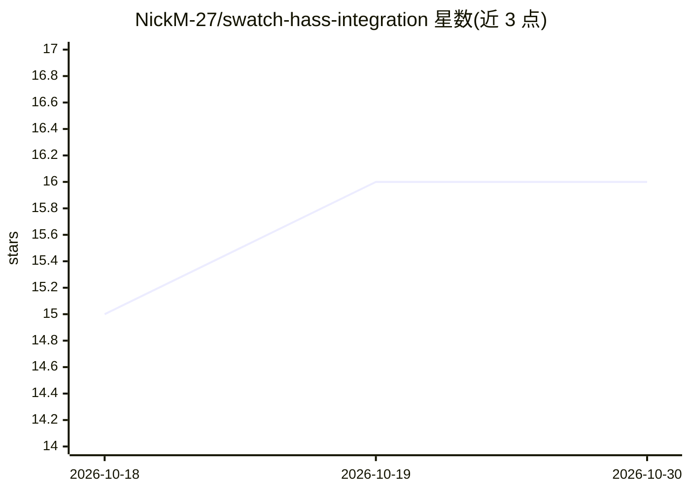

# NickM-27/swatch-hass-integration

⭐ 16 · Python · Apache-2.0 · 推送 2026-01-08 · [GitHub](https://github.com/NickM-27/swatch-hass-integration) · 个人维护

**连接 Swatch 颜色检测服务的 Home Assistant 集成**

Home Assistant 自定义集成：接入 Swatch（基于图像颜色检测已知物体存在与否的服务），生成 Object 与 Zone 检测的二进制传感器实体，支持多个 Swatch 实例。安装可通过 HACS 添加仓库，或手动复制 custom_components/swatch 目录；安装后需在 Configuration > Integrations 中手动添加配置。完整安装与使用说明见 Swatch 主仓库文档，本仓库 README 仅含安装步骤。

## 筛选速览

| 维度 | 判定 | 备注 |
|---|---|---|
| AI 角色 | `ai-enhanced` | 去掉 AI 部分产品仍成立 |
| 许可风险 | `permissive` | Apache-2.0 |
| 部署形态 | `None` |  |
| 模型依赖 | — | README 未给出锁定关系 |
| 硬件要求 | — | 无带数字的原话,不猜 |
| 安装摩擦 | `low` | 无编译、无系统依赖或容器化 |
| 成熟度 | — | 结构信号不足 |

## 能力要点

- 提供 Object + Zone 检测的二进制传感器实体
- 支持接入多个 Swatch 实例
- 可通过 HACS 安装或手动复制 custom_components 目录

## 适用场景

- 在 Home Assistant 中获取 Swatch 的物体存在检测结果
- 基于颜色检测触发家庭自动化场景

## 场景标签

`目标检测` · 领域:感知与多模态

## 证据(README 行号)

> L17: - Binary Sensor entities (Object + Zone detection)
> L33: Please visit the [main Swatch

## 星数曲线

2026-10-18 15 → 2026-10-30 16（+1）

---
*卡片 v1 · prompt 1.4 · 生成 2026-10-30 · 置信度 mid · 依据 README sha `f9a4d84a08f9` · [字段定义](../../DATASET.md)*
