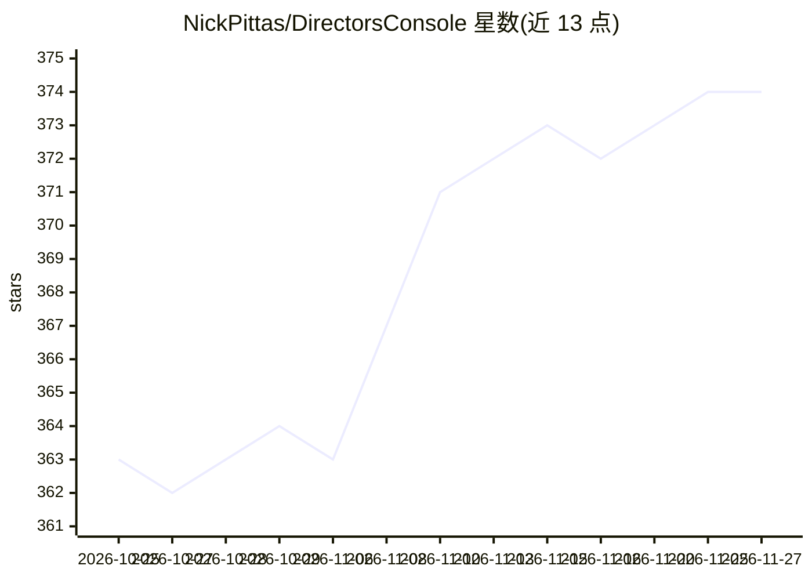

# NickPittas/DirectorsConsole

⭐ 374 · TypeScript · MIT · 推送 2026-11-08 · [GitHub](https://github.com/NickPittas/DirectorsConsole) · 个人维护

**面向影像创作者的 ComfyUI 提示词设计与并行生成工作台**

Web 应用，将电影感提示词工程（CPE）、Storyboard 无限画布与 Gallery 媒体管理整合为一个工作区，三个子应用可互传提示词与媒体。前端通过 ComfyUI REST/WebSocket 直接向本地或远程多个渲染节点并行提交图像/视频工作流；提示词支持规则生成与可选的视觉 LLM 增强；内嵌 Pi/Codex agent 可跨应用操作。渲染依赖已配置模型与自定义节点的 ComfyUI 实例，本应用不自行执行生成。

## 筛选速览

| 维度 | 判定 | 备注 |
|---|---|---|
| AI 角色 | `ai-ecosystem` | LLM/agent 周边工具 |
| 许可风险 | `permissive` | MIT |
| 部署形态 | `None` |  |
| 模型依赖 | — | README 未给出锁定关系 |
| 硬件要求 | — | 无带数字的原话,不猜 |
| 安装摩擦 | `low` | 无编译、无系统依赖或容器化 |
| 成熟度 | — | 结构信号不足 |

## 能力要点

- 多 ComfyUI 节点并行渲染与逐任务进度跟踪
- 规则式提示词生成 + 可选视觉 LLM 图像感知增强
- 分镜头面板管理参数、版本、备注与历史
- 内嵌 Pi/Codex agent 复用本地已装 harness 登录

## 适用场景

- 为影视/动画分镜批量生成与管理图像视频提示词
- 同时向多个 ComfyUI 节点并行提交渲染任务
- 按项目整理、评分、标记与检索生成产物

## 场景标签

`提示工程` `图像生成` `视频生成` · 领域:Agent 开发

## 证据(README 行号)

> L5: Director's Console brings cinematic prompt design, ComfyUI image and video workflows, and media management into one 
> L47: Storyboard is the execution workspace. Import or select a ComfyUI workflow, expose its supported controls, assign p
> L141: - **Frontend:** calls selected ComfyUI nodes directly through REST/WebSocket for workflow generation.

## 星数曲线

2026-10-25 363 → 2026-11-27 374（+11）

---
*卡片 v1 · prompt 1.4 · 生成 2026-11-25 · 置信度 mid · 依据 README sha `7a8fb4eb2fa2` · [字段定义](../../DATASET.md)*
