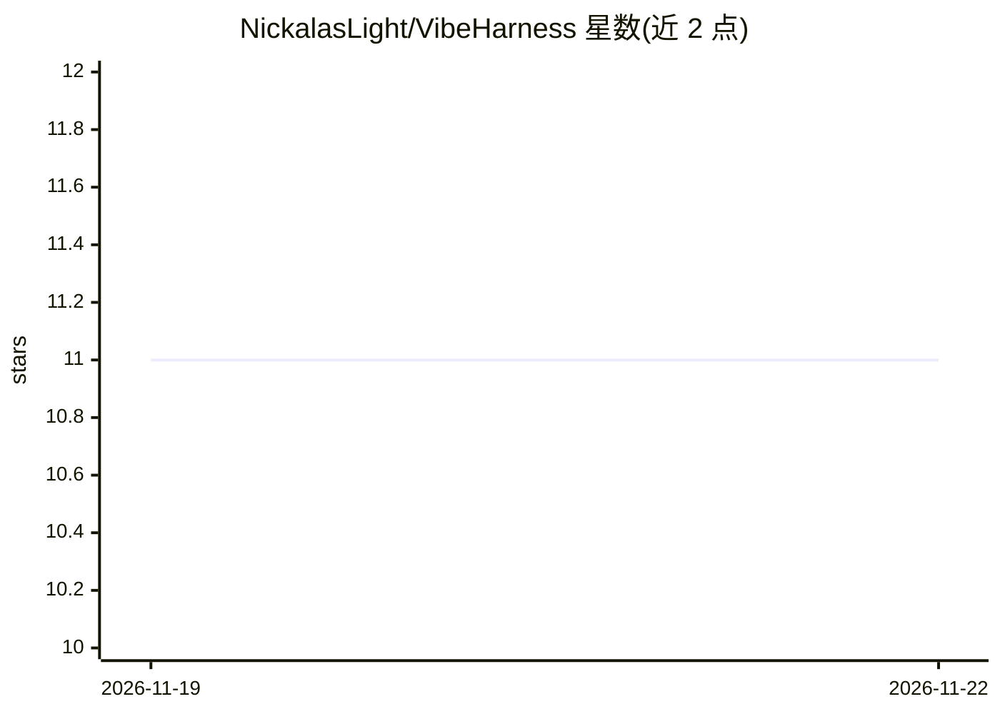

# NickalasLight/VibeHarness

⭐ — · [GitHub]() · 个人维护

**面向小模型本地运行的极简命令行编码 agent 循环**

零运行时依赖的纯 Python agent harness：把经 Ollama 服务的 VibeThinker-3B 变成命令行编码 agent，逐轮对当前目录执行读、写、搜索、文件管理等操作。关键机制包括解码时 JSON schema 约束（Ollama format 语法）、先自由推理后受约束行动的两阶段回合、自然语言叙事式记忆替代 JSON 转录，以及完整推理日志写入隐藏 .vibe/ 目录。文件系统工具集默认提供，浏览器工具集需 Node.js + Playwright CLI。README 明确定位为研究原型，非生产 agent。

## 筛选速览

| 维度 | 判定 | 备注 |
|---|---|---|
| AI 角色 | `ai-ecosystem` | LLM/agent 周边工具 |
| 许可风险 | `permissive` | — |
| 部署形态 | `library` | 以包/库形式分发 |
| 模型依赖 | local-ok | 支持本地模型 |
| 硬件要求 | `cpu-ok` | |
| 安装摩擦 | `medium` | 含编译或系统依赖之一 |
| 成熟度 | `idea` | |

## 能力要点

- 解码时 JSON schema 校验工具调用，两阶段回合（先推理后行动）
- 自然语言叙事式记忆与完整推理日志（.vibe/ 目录）
- 可插拔工具集：内置 fs 与有状态浏览器（Playwright）工具集
- 零运行时依赖，纯 Python 标准库实现

## 适用场景

- 在本地小模型上研究小模型 agentic 行为与工具调用
- 用自然语言任务驱动对当前目录的文件读写与整理
- 通过完整推理日志对比多轮运行、分析小模型出错位置

## 场景标签

`编码 Agent` · 领域:编码与开发

## 证据(README 行号)

> L7: **A tiny, dependency-free Ralph-loop agent harness for small local models.**
> L9: VibeHarness turns a 3B local model (VibeThinker-3B, served by Ollama) into a basic command-line coding agent. You ty
> L41: - **Two-phase turns.** The model first reasons freely, then emits the action(s) under the schema constraint. (This 

## 星数曲线

2026-11-19 11 → 2026-11-22 11（+0）

---
*卡片 v1 · prompt 1.4 · 生成 2026-11-19 · 置信度 mid · 依据 README sha `f84602703964` · [字段定义](../../DATASET.md)*
