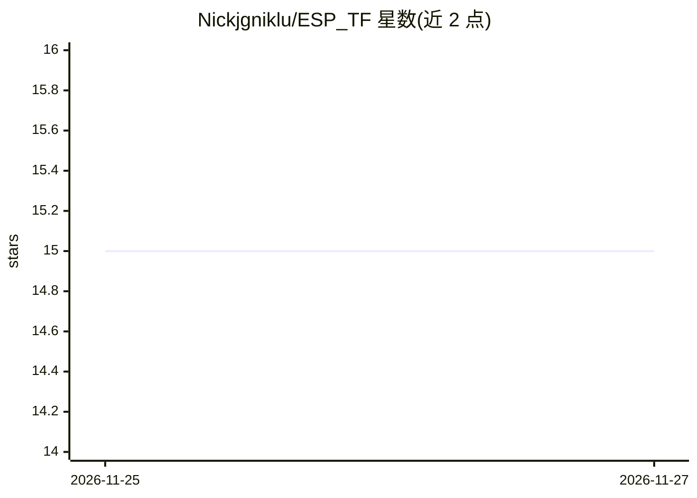

# Nickjgniklu/ESP_TF

⭐ 15 · C++ · NOASSERTION · 推送 2026-11-13 · [GitHub](https://github.com/Nickjgniklu/ESP_TF) · 个人维护

**把乐鑫 TFLite Micro 仓库重组为 Arduino 兼容的推理库**

该库通过 create.sf 脚本从 espressif 的 tflite-micro-esp-examples 仓库更新并重组源码，使其在 Arduino IDE 与 PlatformIO 下均可构建。示例 HelloESP_TF 加载训练好的 MNIST 数字分类模型，对内置的 5 张测试图运行推理，输出 PASS/FAIL 与单张耗时。通过预处理宏（ESP_NN、CONFIG_NN_OPTIMIZED、ARCH_ESP32_S3）启用 ESP32-S3 汇编内核优化；Arduino IDE 需以 sketch 目录下的 build_opt.h 传递编译标志。2.1.0 之前的版本在 Arduino IDE 下构建 ESP32-S3 会失败。

## 筛选速览

| 维度 | 判定 | 备注 |
|---|---|---|
| AI 角色 | `ai-native` | 本体是模型或模型工具 |
| 许可风险 | `none` | NOASSERTION |
| 部署形态 | `None` |  |
| 模型依赖 | — | README 未给出锁定关系 |
| 硬件要求 | — | 无带数字的原话,不猜 |
| 安装摩擦 | `medium` | 含编译或系统依赖之一 |
| 成熟度 | — | 结构信号不足 |

## 能力要点

- 在 Arduino IDE 与 PlatformIO 下均直接构建运行
- ESP32-S3 汇编内核优化，示例推理耗时 ~1325ms 降至 ~21ms 且输出字节一致
- 内置真实 MNIST 模型离线推理示例，无需摄像头或网络
- 记录 arduino-cli 验证过的构建配置与内核链接结果

## 适用场景

- 在 ESP32/ESP32-S3 上以 Arduino 工作流运行 TFLite Micro 模型
- 为 TinyML 项目启用 ESP_NN 优化内核
- 离线验证模型在 ESP32-S3 上的推理结果与耗时

## 场景标签

`推理引擎` · 领域:训练与推理

## 证据(README 行号)

> L2: 1. run create.sf to update source this library just restructures the espressif tensorflow repo (https://github.com/e
> L7: runs inference on five real MNIST test images bundled in the sketch (no
> L39: Building with `ESP_NN`, `CONFIG_NN_OPTIMIZED`, and `ARCH_ESP32_S3` will enable ESP32-S3 specific optimizations.

## 星数曲线

2026-11-25 15 → 2026-11-27 15（+0）

---
*卡片 v1 · prompt 1.4 · 生成 2026-11-24 · 置信度 high · 依据 README sha `75f18cc635ac` · [字段定义](../../DATASET.md)*
