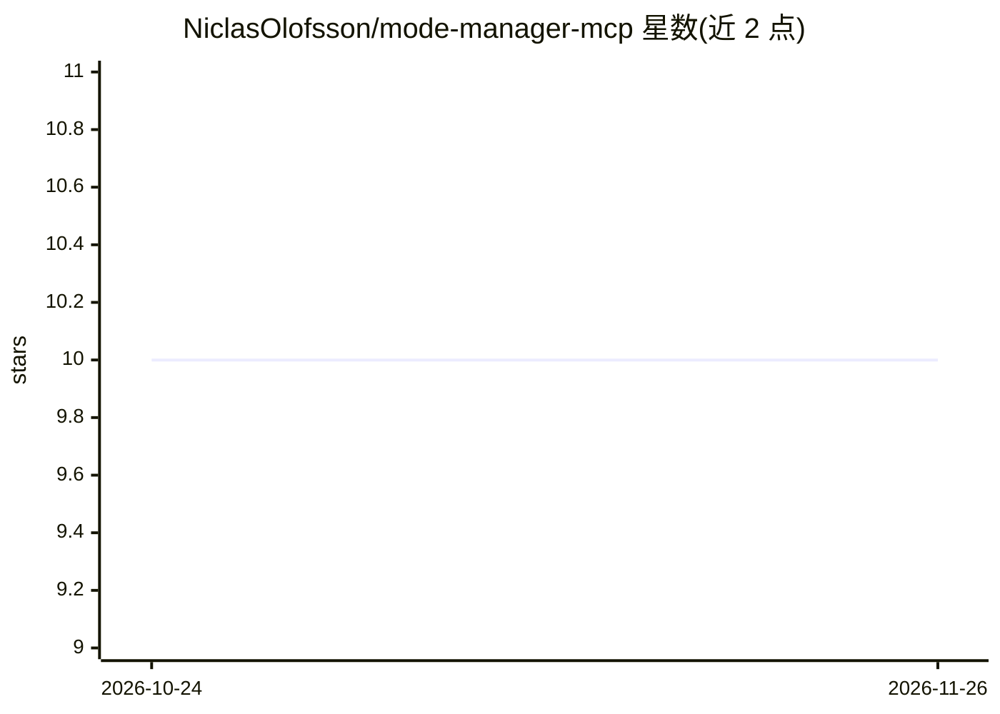

# NiclasOlofsson/mode-manager-mcp

⭐ 10 · Python · MIT · 推送 2026-01-01 · [GitHub](https://github.com/NiclasOlofsson/mode-manager-mcp) · 个人维护

**为 VS Code Copilot 提供持久记忆与指令管理的 MCP 服务器**

Mode Manager MCP 是一个面向开发者和团队的 MCP 服务器，通过 VS Code Copilot Chat 存储、读取个人、工作区（团队）与语言级三类记忆，内容以带 YAML frontmatter 的 Markdown 文件保存在 VS Code prompts 目录与 .github/instructions 目录，每轮对话由 Copilot Chat 自动加载。支持自然语言

## 筛选速览

| 维度 | 判定 | 备注 |
|---|---|---|
| AI 角色 | `ai-ecosystem` | LLM/agent 周边工具 |
| 许可风险 | `permissive` | MIT |
| 部署形态 | `library` | 以包/库形式分发 |
| 模型依赖 | — | README 未给出锁定关系 |
| 硬件要求 | — | 无带数字的原话,不猜 |
| 安装摩擦 | `low` | 无编译、无系统依赖或容器化 |
| 成熟度 | — | 结构信号不足 |

## 能力要点

- 三级记忆作用域：个人/工作区团队/语言专属
- 记忆以带 YAML frontmatter 的 Markdown 文件持久化，含时间戳
- 按 applyTo 文件模式（如 **/*.py）自动加载对应语言记忆
- 提供 VS Code 一键安装与交互式 onboarding 提示

## 适用场景

- 让 Copilot 记住个人编码偏好并在后续对话中生效
- 团队把编码规范和入职知识存进仓库供成员共享
- 按语言自动应用对应框架的最佳实践提示

## 场景标签

`提示工程` `Agent 记忆` · 领域:Agent 开发

## 证据(README 行号)

> L10: Mode Manager MCP is an AI-powered memory and context system for developers and teams. It lets you and your team “re
> L141: Mode Manager MCP is designed to make memory persistent, context-aware, and
> L166: Here’s the magic: Mode Manager MCP writes and manages all your memory files,

## 星数曲线

2026-10-24 10 → 2026-11-26 10（+0）

---
*卡片 v1 · prompt 1.4 · 生成 2026-11-20 · 置信度 mid · 依据 README sha `001de85ff061` · [字段定义](../../DATASET.md)*
