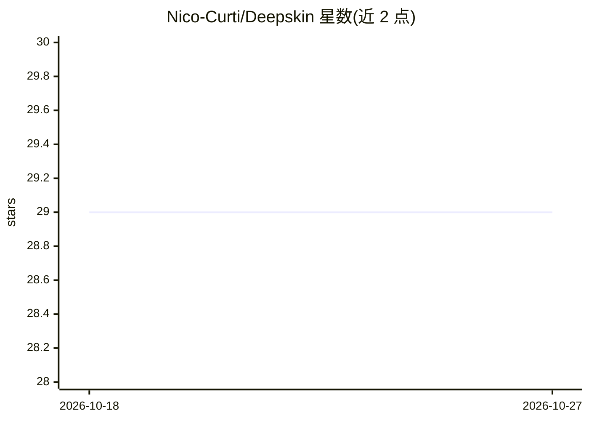

# Nico-Curti/Deepskin

⭐ 29 · Python · NOASSERTION · 推送 2026-07-22 · [GitHub](https://github.com/Nico-Curti/Deepskin) · [官网](https://deepskin.readthedocs.io/en/latest/?badge=latest) · 组织维护

**智能手机伤口图像分割与 PWAT 评分预测的 Python 库**

International Journal of Molecular Science 所载 deepskin 算法的官方 Python 实现：以 U-Net 模型对智能手机拍摄的伤口照片做多类语义分割（背景/患者身体/标记物/伤口四类 ROI），再用形态学算子提取伤口周围区域，从两个 ROI 提取可解释特征，经回归模型自动预测 PWAT（Photographic Wound Assessment Tool）评分，输出连续值。训练采用主动半监督学习（ASSL）策略。提供 Python API 与 deepskin 命令行；从源码经 setup.py 安装。已知限制：TensorFlow ≥2.16.1 需设置 TF_USE_LEGACY_KERAS 否则可能产生错误分割。

## 筛选速览

| 维度 | 判定 | 备注 |
|---|---|---|
| AI 角色 | `ai-native` | 本体是模型或模型工具 |
| 许可风险 | `none` | NOASSERTION |
| 部署形态 | `library` | 以包/库形式分发 |
| 模型依赖 | — | README 未给出锁定关系 |
| 硬件要求 | — | 无带数字的原话,不猜 |
| 安装摩擦 | `low` | 无编译、无系统依赖或容器化 |
| 成熟度 | `idea` | |

## 能力要点

- U-Net 多类语义分割：背景/患者身体/标记物/伤口四类 ROI
- 形态学算子提取 peri-wound 区域并独立提取特征
- 回归模型自动预测 PWAT 评分（连续浮点值）
- 提供 Python API 与命令行两种使用方式

## 适用场景

- 临床实践中对伤口照片自动分割并估计严重程度评分
- 伤口愈合研究中的自动化图像定量分析
- 对患者按伤口严重程度做更细粒度分层

## 场景标签

`目标检测` · 领域:感知与多模态

## 证据(README 行号)

> L26: Using the `deepskin` package you can directly use the latest version of the model, obtaining for each image a seman
> L40: This task is address using a deep learning U-Net model trained on a large set of images.
> L51: Using the obtained segmentation mask, we developed a second step of processing for the automated estimation of the 

## 星数曲线

2026-10-18 29 → 2026-10-27 29（+0）

---
*卡片 v1 · prompt 1.4 · 生成 2026-10-26 · 置信度 mid · 依据 README sha `b19c0526620a` · [字段定义](../../DATASET.md)*
