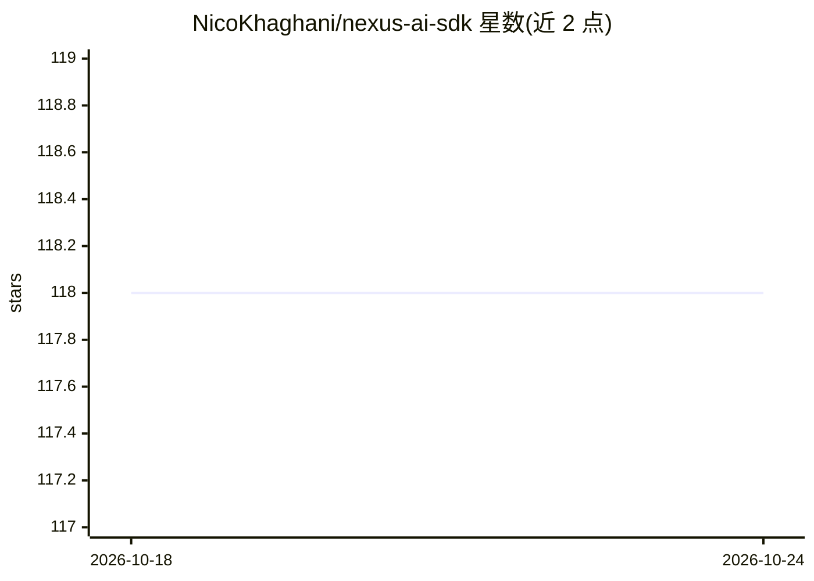

# NicoKhaghani/nexus-ai-sdk

⭐ 118 · TypeScript · MIT · 推送 2026-06-14 · [GitHub](https://github.com/NicoKhaghani/nexus-ai-sdk) · 个人维护

**TypeScript 的 Quest 式 AI 执行编排运行时**

面向 TypeScript 开发者的 AI 执行编排 SDK（monorepo）：将单一目标转化为 Quest 计划，分解为依赖图步骤，并行执行独立步骤，按声明的 schema 验证输出并组装交付物。默认 Private Mode 无需外部 LLM 依赖，Extended Mode 可接入开发者配置的外部模型与 API，运行时保持 provider 无关。内置 x402 结算（ERC-3009 授权、先结算后执行），并声明为 alpha 阶段，facilitator 防重放为内存实现，不适用于生产。

## 筛选速览

| 维度 | 判定 | 备注 |
|---|---|---|
| AI 角色 | `ai-ecosystem` | LLM/agent 周边工具 |
| 许可风险 | `permissive` | MIT |
| 部署形态 | `None` |  |
| 模型依赖 | — | README 未给出锁定关系 |
| 硬件要求 | — | 无带数字的原话,不猜 |
| 安装摩擦 | `low` | 无编译、无系统依赖或容器化 |
| 成熟度 | `idea` | |

## 能力要点

- objective → Quest Plan → 依赖图 → 验证 → 组装的编排管线
- 默认 Private Mode 无外部 LLM 依赖，provider 无关
- x402 结算：runPaidQuest 先完成支付再执行 Quest
- 运行时观测、重试与并行执行支持

## 适用场景

- 把一个目标拆解为结构化的多步骤 AI 工作流并自动执行
- 在私有环境内编排内部能力而不接外部模型
- 为整个工作流挂单次链上付费门槛

## 场景标签

`Agent 框架` · 领域:Agent 开发

## 证据(README 行号)

> L8: Build, observe, and settle **Quest-based AI execution** through a unified orchestration surface.
> L31: Nexus AI orchestrates capabilities. A capability may be internal, private, API-backed, model-backed, or fully custo

## 星数曲线

2026-10-18 118 → 2026-10-24 118（+0）

---
*卡片 v1 · prompt 1.4 · 生成 2026-10-23 · 置信度 high · 依据 README sha `10639b914693` · [字段定义](../../DATASET.md)*
