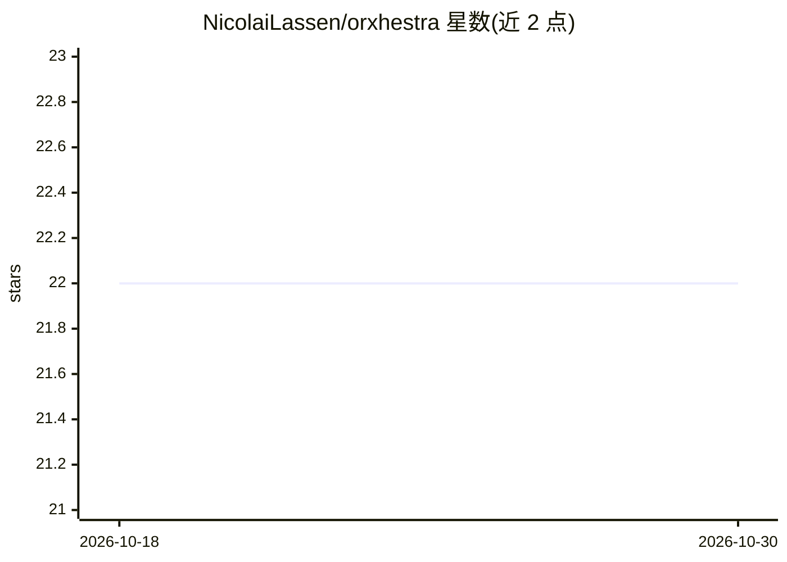

# NicolaiLassen/orxhestra

⭐ 22 · Python · Apache-2.0 · 推送 2026-05-10 · [GitHub](https://github.com/NicolaiLassen/orxhestra) · [官网](https://orxhestra.com) · 个人维护

**Python 多智能体编排框架：将 agent 配置转为 CLI 或服务器**

面向开发者的多智能体编排框架，提供 LlmAgent、ReAct、Sequential、Parallel、Loop 等 agent 类型，支持 29 个 LLM 提供商、MCP 全规范客户端与 A2A v1.0 服务端/客户端。可用声明式 YAML（Composer）编排 agent 团队，无需 Python 接线，并以 `orx` 命令转为交互式终端 agent（自带 coding agent）或 A2A 服务器。另含可选的 Ed25519 身份签名、DID 验证与审计日志，以及 Langfuse/LangSmith 追踪。通过 pip/uv 安装，提供 Docker 镜像。

## 筛选速览

| 维度 | 判定 | 备注 |
|---|---|---|
| AI 角色 | `ai-ecosystem` | LLM/agent 周边工具 |
| 许可风险 | `permissive` | Apache-2.0 |
| 部署形态 | `self-host` | docker 或自建部署 |
| 模型依赖 | local-ok | 支持本地模型 |
| 硬件要求 | — | 无带数字的原话,不猜 |
| 安装摩擦 | `low` | 无编译、无系统依赖或容器化 |
| 成熟度 | — | 结构信号不足 |

## 能力要点

- 29 个 LLM 提供商接入（OpenAI/Anthropic/Ollama 等）
- 声明式 YAML（Composer）编排多 agent 并可 --serve 暴露为 A2A 服务器
- MCP 全规范客户端与 A2A v1.0 双向支持
- 可选 Ed25519 事件签名、DID 验证与哈希链审计日志

## 适用场景

- 用 YAML 定义 agent 团队并一键转为终端 CLI 或 A2A 服务
- 构建带工具调用、规划与子 agent 委派的编码 agent
- 通过 MCP 接入外部工具与资源，跨 agent 用 A2A 互联

## 场景标签

`Agent 框架` `多智能体` · 领域:Agent 开发

## 证据(README 行号)

> L3:  Multi-agent orchestration framework for Python — turn any agent setup into a CLI or server.
> L9: Compose multi-agent AI systems with async event streaming, agent hierarchies, and built-in support for MCP and A2A p
> L110: - **Agent ensemble** - LLM, ReAct, Sequential, Parallel, and Loop agents

## 星数曲线

2026-10-18 22 → 2026-10-30 22（+0）

---
*卡片 v1 · prompt 1.4 · 生成 2026-10-27 · 置信度 high · 依据 README sha `93389ff578ef` · [字段定义](../../DATASET.md)*
