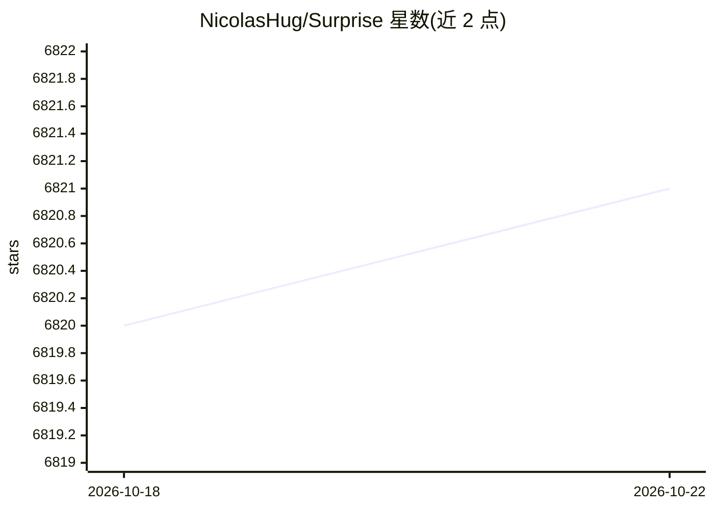

# NicolasHug/Surprise

⭐ 6,821 · Python · BSD-3-Clause · 推送 2026-05-30 · [GitHub](https://github.com/NicolasHug/Surprise) · [官网](http://surpriselib.com) · 个人维护

**Python 推荐系统库：构建与分析显式评分预测算法**

面向显式评分数据的推荐系统 Python scikit：内置基线算法、邻域方法（k-NN 系列）、矩阵分解（SVD、PMF、SVD++、NMF）、Slope One、Co-Clustering 等预测算法与多种相似度度量，支持内置数据集（Movielens、Jester）与自定义数据集，提供交叉验证与 GridSearchCV 参数搜索、基准评测工具，并可自定义算法。不支持隐式评分与基于内容的信息。通过 pip/conda 安装，源码构建需 Cython 与 numpy。作者声明自 1.1.0 起仅做维护与修 bug，不再新增功能。

## 筛选速览

| 维度 | 判定 | 备注 |
|---|---|---|
| AI 角色 | `ai-native` | 本体是模型或模型工具 |
| 许可风险 | `permissive` | BSD-3-Clause |
| 部署形态 | `library` | 以包/库形式分发 |
| 模型依赖 | — | README 未给出锁定关系 |
| 硬件要求 | — | 无带数字的原话,不猜 |
| 安装摩擦 | `low` | 无编译、无系统依赖或容器化 |
| 成熟度 | — | 结构信号不足 |

## 能力要点

- 内置 SVD/SVD++/NMF/k-NN 等多种预测算法与相似度度量
- 交叉验证与 GridSearchCV 参数穷举搜索
- 支持内置数据集（Movielens/Jester）与自定义数据集
- 提供 Movielens 100k/1M 上的 RMSE/MAE/耗时基准表

## 适用场景

- 在显式评分数据上快速实验多种推荐算法
- 用交叉验证与网格搜索评测、调参并比较算法
- 实现并验证自己的推荐算法想法

## 场景标签

`推荐系统` · 领域:学习与行业

## 证据(README 行号)

> L11: Surprise is a Python
> L29: - Provide various ready-to-use [prediction

## 星数曲线

2026-10-18 6,820 → 2026-10-22 6,821（+1）

---
*卡片 v1 · prompt 1.4 · 生成 2026-10-20 · 置信度 high · 依据 README sha `d8f946adeca4` · [字段定义](../../DATASET.md)*
